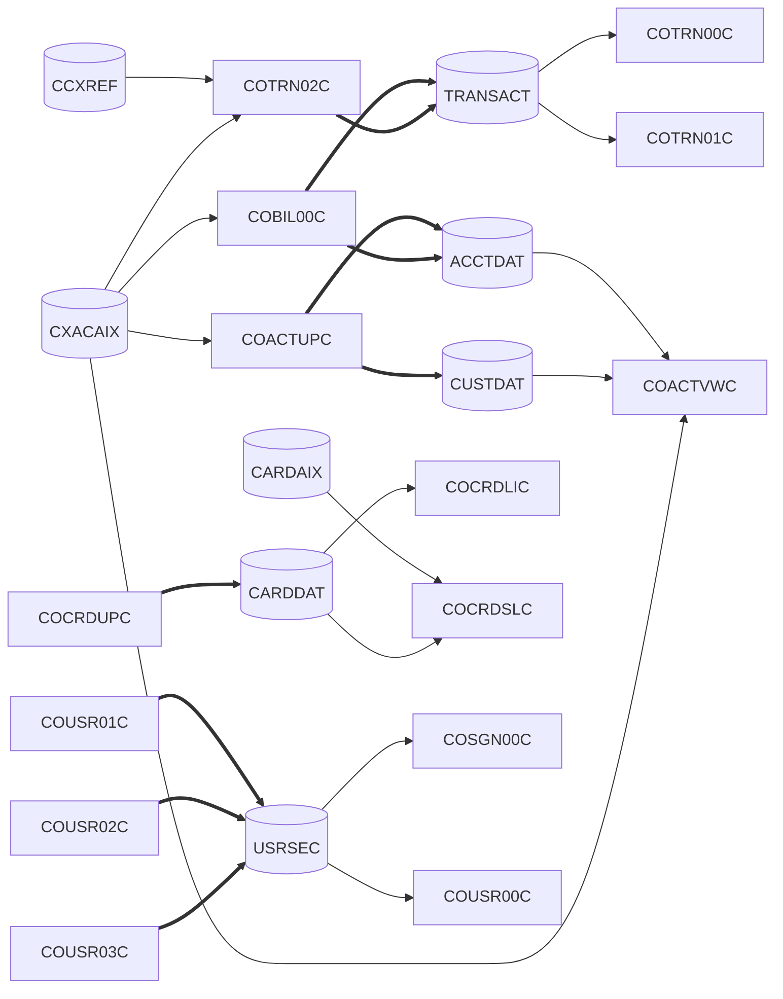
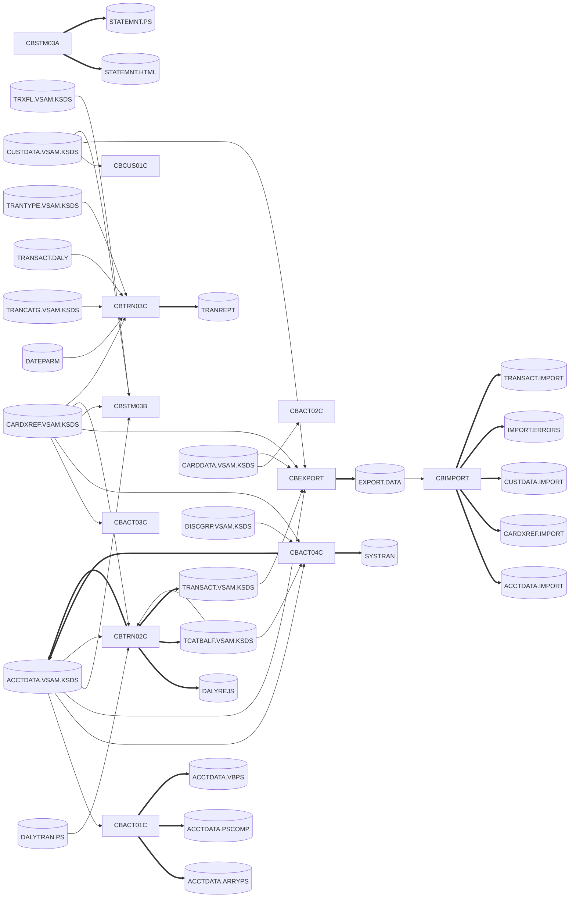

# CardDemo source inventory (BNP-2)

Master index of the COBOL/CICS source in
[`ipsorakis/aws-mainframe-modernization-carddemo`](https://github.com/ipsorakis/aws-mainframe-modernization-carddemo)
(read-only reference). Each port ticket in Jira project BNP can trace a Python module back to the
programs, copybooks, maps, JCL and datasets listed here.

| File | Contents |
|---|---|
| [`inventory.csv`](inventory.csv) | One row per git-tracked file under `app/cbl`, `app/cpy`, `app/bms`, `app/jcl`, `app/scheduler`, `app/csd`, `app/cpy-bms`, `app/data`, plus `app/proc`, `app/ctl`, `app/asm`, `app/maclib`, `app/catlg`. Columns: `path, type, name, category, purpose, lines, bytes`. |
| [`dependencies.csv`](dependencies.csv) | One row per edge. Columns: `from, to, kind, from_type, to_type, record_copybook, detail, source` (`source` = `path:line` of every occurrence). |
| [`tools/build_inventory.py`](tools/build_inventory.py) | Generates both CSVs and the generated block of this README. Python 3 stdlib only. |

Detail documents (written under the BNP-2 subtasks):

- Online CICS programs and BMS screens: [`online.md`](online.md) (BNP-3)
- Batch programs, JCL and schedulers: [`batch.md`](batch.md) (BNP-4)
- Field-level record layouts: [`copybooks/README.md`](copybooks/README.md) (BNP-5)

Scope is the top level of `app/`. The source repo also holds three optional extensions, which are not inventoried
here: `app/app-authorization-ims-db2-mq/`, `app/app-transaction-type-db2/`, `app/app-vsam-mq/`.

## Regenerating and checking coverage

```sh
git clone https://github.com/ipsorakis/aws-mainframe-modernization-carddemo ../carddemo
python3 docs/inventory/tools/build_inventory.py ../carddemo          # rewrite CSVs + generated block below
python3 docs/inventory/tools/build_inventory.py ../carddemo --check  # coverage only
```

Both commands exit non-zero if a file returned by `git ls-files` for the scanned folders is missing from
`inventory.csv`, is listed twice, or no longer exists. Output is sorted, so a rerun on the same commit gives no diff.

## How the columns are derived

- **type**: from the folder: `program` (`app/cbl`), `copybook` (`app/cpy` and the BMS symbolic maps in `app/cpy-bms`),
  `bms`, `jcl`, `scheduler`, `csd`, `data`, plus `proc`, `control`, `assembler`, `macro`, `catalog` for the extra
  folders. `.gitkeep` files are rows of type `placeholder`.
- **category**: programs containing `EXEC CICS` are `online`. A program with no CICS whose header says UTILITY, or that
  is CALLed by an online program, is `utility` (COBSWAIT, CSUTLDTC). Everything else in `app/cbl` is `batch`.
  Copybooks take the category of the programs that COPY them (`online`, `batch`, `online+batch`, or `unused`).
  JCL/PROC members that run a CardDemo program are `batch`; IDCAMS/SORT/SDSF-only members are `utility`. Data,
  catalog and placeholders are `n/a`.
- **purpose**: the `Function :` line of the program header, the first descriptive header comment of a copybook/BMS
  map, or the JOB card programmer-name text (else the first descriptive `//*` comment) of a JCL member. Where the
  header has no description the script says so and describes what it found instead ("No header description; defines
  01 ..."). Nothing in the purpose column is hand-written.
- **edges** come from the source text, not from naming conventions:
  - `COPY`: `COPY` statements, comment lines skipped.
  - `CALL`: static `CALL 'literal'`.
  - `XCTL` / `LINK` / `RETURN-TRANSID` / `SEND MAP` / `RECEIVE MAP`: `EXEC CICS` blocks. When the option is a
    variable, its possible values are resolved from `VALUE` clauses and `MOVE ... TO` statements in the program
    and its copybooks; menu programs are resolved from the option tables in `COMEN02Y` / `COADM02Y`. When a
    target can also come from the COMMAREA (e.g. `CDEMO-FROM-PROGRAM`), an extra `(dynamic: ...)` edge records
    it.
  - `CICS READ/WRITE/REWRITE/DELETE`: `EXEC CICS READ/READNEXT/READPREV/STARTBR/WRITE/REWRITE/DELETE` with
    `DATASET(...)` or `FILE(...)`, resolved to the CICS file name; `record_copybook` comes from `INTO(...)` /
    `FROM(...)`.
  - Batch `READ/WRITE/REWRITE/DELETE`: `SELECT ... ASSIGN TO <dd>`, the `FD` records and the procedure-division
    verbs; `to` is the DD name. `OPEN only` marks files that are opened but never read or written.
  - `EXEC PGM=` / `EXEC PROC=` / `JCL DD->DSN` (`from` = `MEMBER.STEP.DD`), `IDCAMS DEFINE/DELETE` from in-stream
    SYSIN (with KEYS/RECORDSIZE/RELATE), `CEMT SET FILE OPEN/CLOSE` from SDSF steps, `SUBMIT via INTRDR`.
  - `CSD FILE DSNAME`, `CSD TRANSACTION PROGRAM` from `app/csd/CARDDEMO.CSD`.
  - `CONTROL-M JOB`, `CONTROL-M INCOND` (predecessor → successor) from `CardDemo.controlm`; `CA-7 TRIGGER` from the
    `TRIGGERED JOBS` sections of `CardDemo.ca7`.
- The program and data-file tables below join these edges: a batch program's DD name is matched with the DSN of the
  same DD in every JCL step that runs it (a CALLed subroutine inherits its caller's DDs, e.g. CBSTM03B).

## Generated overview

<!-- BEGIN GENERATED: build_inventory.py -->
Source commit scanned: `59cc6c2fd7ebd7ef7925cad552a01a4b8b6e4d5e` (`ipsorakis/aws-mainframe-modernization-carddemo`, `main`).

| Folder | Files (git ls-files) | Excluding .gitkeep | Ticket BNP-2 | Match |
|---|---|---|---|---|
| `app/cbl/` | 31 | 31 | 31 | yes |
| `app/cpy/` | 30 | 30 | 30 | yes |
| `app/bms/` | 17 | 17 | 17 | yes |
| `app/jcl/` | 38 | 38 | 38 | yes |
| `app/scheduler/` | 2 | 2 | 2 | yes |
| `app/csd/` | 2 | 1 | not listed | n/a |
| `app/cpy-bms/` | 18 | 17 | not listed | n/a |
| `app/data/` | 23 | 22 | not listed | n/a |
| `app/proc/` | 2 | 2 | not listed | n/a |
| `app/ctl/` | 1 | 1 | not listed | n/a |
| `app/asm/` | 2 | 2 | not listed | n/a |
| `app/maclib/` | 2 | 2 | not listed | n/a |
| `app/catlg/` | 1 | 1 | not listed | n/a |
| **Total** | 169 | 166 | | |

`dependencies.csv` holds 767 edges: CA-7 TRIGGER 24, CALL 17, CEMT SET FILE CLOSE 10, CEMT SET FILE OPEN 10, CICS DELETE 1, CICS READ 22, CICS REWRITE 5, CICS WRITE 3, CONTROL-M INCOND 10, CONTROL-M JOB 15, COPY 214, CSD FILE DSNAME 8, CSD TRANSACTION PROGRAM 18, EXEC PGM= 58, EXEC PROC= 4, IDCAMS DEFINE AIX 4, IDCAMS DEFINE CLUSTER 16, IDCAMS DEFINE PATH 4, IDCAMS DELETE 21, JCL DD->DSN 137, OPEN only (no READ/WRITE) 3, READ 30, RECEIVE MAP 17, RETURN-TRANSID 17, REWRITE 3, SEND MAP 17, SUBMIT JCL (EXEC PROC=) 1, SUBMIT via INTRDR 1, WRITE 17, WRITEQ TD 1, XCTL 59.

### Programs

Files: online programs show CICS file names (CSD); batch programs show `DDNAME=DSN` from the JCL steps that run them (DSN prefix `AWS.M2.CARDDEMO.` dropped). R=read, W=write, U=rewrite, D=delete.

| Program | Category | Entry (CSD transaction / JCL) | Copybooks used | Files read/written | Transfers control to (XCTL / CALL / LINK) |
|---|---|---|---|---|---|
| `CBACT01C` | batch | READACCT | CODATECN, CVACT01Y | ACCTFILE=ACCTDATA.VSAM.KSDS (R), ARRYFILE=ACCTDATA.ARRYPS (W), OUTFILE=ACCTDATA.PSCOMP (W), VBRCFILE=ACCTDATA.VBPS (W) | CEE3ABD (CALL), COBDATFT (CALL) |
| `CBACT02C` | batch | READCARD | CVACT02Y | CARDFILE=CARDDATA.VSAM.KSDS (R) | CEE3ABD (CALL) |
| `CBACT03C` | batch | READXREF | CVACT03Y | XREFFILE=CARDXREF.VSAM.KSDS (R) | CEE3ABD (CALL) |
| `CBACT04C` | batch | INTCALC | CVACT01Y, CVACT03Y, CVTRA01Y, CVTRA02Y, CVTRA05Y | ACCTFILE=ACCTDATA.VSAM.KSDS (RU), DISCGRP=DISCGRP.VSAM.KSDS (R), TCATBALF=TCATBALF.VSAM.KSDS (R), TRANSACT=SYSTRAN (W), XREFFILE=CARDXREF.VSAM.KSDS (R) | CEE3ABD (CALL) |
| `CBCUS01C` | batch | READCUST | CVCUS01Y | CUSTFILE=CUSTDATA.VSAM.KSDS (R) | CEE3ABD (CALL) |
| `CBEXPORT` | batch | CBEXPORT | CVACT01Y, CVACT02Y, CVACT03Y, CVCUS01Y, CVEXPORT, CVTRA05Y | ACCTFILE=ACCTDATA.VSAM.KSDS (R), CARDFILE=CARDDATA.VSAM.KSDS (R), CUSTFILE=CUSTDATA.VSAM.KSDS (R), EXPFILE=EXPORT.DATA (W), TRANSACT=TRANSACT.VSAM.KSDS (R), XREFFILE=CARDXREF.VSAM.KSDS (R) | CEE3ABD (CALL) |
| `CBIMPORT` | batch | CBIMPORT | CVACT01Y, CVACT02Y, CVACT03Y, CVCUS01Y, CVEXPORT, CVTRA05Y | ACCTOUT=ACCTDATA.IMPORT (W), CARDOUT=no JCL DD (W), CUSTOUT=CUSTDATA.IMPORT (W), ERROUT=IMPORT.ERRORS (W), EXPFILE=EXPORT.DATA (R), TRNXOUT=TRANSACT.IMPORT (W), XREFOUT=CARDXREF.IMPORT (W) | CEE3ABD (CALL) |
| `CBSTM03A` | batch | CREASTMT | COSTM01, CUSTREC, CVACT01Y, CVACT03Y | HTMLFILE=STATEMNT.HTML (W), STMTFILE=STATEMNT.PS (W) | CBSTM03B (CALL), CEE3ABD (CALL) |
| `CBSTM03B` | batch | CALLed by CBSTM03A | - | ACCTFILE=ACCTDATA.VSAM.KSDS (R), CUSTFILE=CUSTDATA.VSAM.KSDS (R), TRNXFILE=TRXFL.VSAM.KSDS (R), XREFFILE=CARDXREF.VSAM.KSDS (R) | - |
| `CBTRN01C` | batch | **none found** | CVACT01Y, CVACT02Y, CVACT03Y, CVCUS01Y, CVTRA05Y, CVTRA06Y | ACCTFILE=no JCL DD (R), DALYTRAN=no JCL DD (R), XREFFILE=no JCL DD (R) | CEE3ABD (CALL) |
| `CBTRN02C` | batch | POSTTRAN | CVACT01Y, CVACT03Y, CVTRA01Y, CVTRA05Y, CVTRA06Y | ACCTFILE=ACCTDATA.VSAM.KSDS (RU), DALYREJS=DALYREJS (W), DALYTRAN=DALYTRAN.PS (R), TCATBALF=TCATBALF.VSAM.KSDS (RWU), TRANFILE=TRANSACT.VSAM.KSDS (W), XREFFILE=CARDXREF.VSAM.KSDS (R) | CEE3ABD (CALL) |
| `CBTRN03C` | batch | TRANREPT | CVACT03Y, CVTRA03Y, CVTRA04Y, CVTRA05Y, CVTRA07Y | CARDXREF=CARDXREF.VSAM.KSDS (R), DATEPARM=DATEPARM (R), TRANCATG=TRANCATG.VSAM.KSDS (R), TRANFILE=TRANSACT.DALY (R), TRANREPT=TRANREPT (W), TRANTYPE=TRANTYPE.VSAM.KSDS (R) | CEE3ABD (CALL) |
| `COACTUPC` | online | CAUP | COACTUP, COCOM01Y, COTTL01Y, CSDAT01Y, CSLKPCDY, CSMSG01Y, CSMSG02Y, CSSETATY, CSSTRPFY, CSUSR01Y, CSUTLDPY, CSUTLDWY, CVACT01Y, CVACT03Y, CVCRD01Y, CVCUS01Y | ACCTDAT (RU), CUSTDAT (RU), CXACAIX (R) | COMEN01C, caller via COMMAREA |
| `COACTVWC` | online | CAVW | COACTVW, COCOM01Y, COTTL01Y, CSDAT01Y, CSMSG01Y, CSMSG02Y, CSSTRPFY, CSUSR01Y, CVACT01Y, CVACT02Y, CVACT03Y, CVCRD01Y, CVCUS01Y | ACCTDAT (R), CUSTDAT (R), CXACAIX (R) | COMEN01C, caller via COMMAREA |
| `COADM01C` | online | CA00 | COADM01, COADM02Y, COCOM01Y, COTTL01Y, CSDAT01Y, CSMSG01Y, CSUSR01Y | - | COSGN00C, COTRTLIC, COTRTUPC, COUSR00C, COUSR01C, COUSR02C, COUSR03C |
| `COBIL00C` | online | CB00 | COBIL00, COCOM01Y, COTTL01Y, CSDAT01Y, CSMSG01Y, CVACT01Y, CVACT03Y, CVTRA05Y | ACCTDAT (RU), CXACAIX (R), TRANSACT (RW) | COMEN01C, COSGN00C, caller via COMMAREA |
| `COBSWAIT` | utility | WAITSTEP | - | - | MVSWAIT (CALL) |
| `COCRDLIC` | online | CCLI | COCOM01Y, COCRDLI, COTTL01Y, CSDAT01Y, CSMSG01Y, CSSTRPFY, CSUSR01Y, CVACT02Y, CVCRD01Y | CARDDAT (R) | COCRDSLC, COCRDUPC, COMEN01C |
| `COCRDSLC` | online | CCDL | COCOM01Y, COCRDSL, COTTL01Y, CSDAT01Y, CSMSG01Y, CSMSG02Y, CSSTRPFY, CSUSR01Y, CVACT02Y, CVCRD01Y, CVCUS01Y | CARDAIX (R), CARDDAT (R) | COMEN01C, caller via COMMAREA |
| `COCRDUPC` | online | CCUP | COCOM01Y, COCRDUP, COTTL01Y, CSDAT01Y, CSMSG01Y, CSMSG02Y, CSSTRPFY, CSUSR01Y, CVACT02Y, CVCRD01Y, CVCUS01Y | CARDDAT (RU) | COMEN01C, caller via COMMAREA |
| `COMEN01C` | online | CM00 | COCOM01Y, COMEN01, COMEN02Y, COTTL01Y, CSDAT01Y, CSMSG01Y, CSUSR01Y | - | COACTUPC, COACTVWC, COBIL00C, COCRDLIC, COCRDSLC, COCRDUPC, COPAUS0C, CORPT00C, COSGN00C, COTRN00C, COTRN01C, COTRN02C |
| `CORPT00C` | online | CR00 | COCOM01Y, CORPT00, COTTL01Y, CSDAT01Y, CSMSG01Y, CVTRA05Y | - | COMEN01C, COSGN00C, CSUTLDTC (CALL) |
| `COSGN00C` | online | CC00 | COCOM01Y, COSGN00, COTTL01Y, CSDAT01Y, CSMSG01Y, CSUSR01Y | USRSEC (R) | COADM01C, COMEN01C |
| `COTRN00C` | online | CT00 | COCOM01Y, COTRN00, COTTL01Y, CSDAT01Y, CSMSG01Y, CVTRA05Y | TRANSACT (R) | COMEN01C, COSGN00C, COTRN01C |
| `COTRN01C` | online | CT01 | COCOM01Y, COTRN01, COTTL01Y, CSDAT01Y, CSMSG01Y, CVTRA05Y | TRANSACT (R) | COMEN01C, COSGN00C, COTRN00C, caller via COMMAREA |
| `COTRN02C` | online | CT02 | COCOM01Y, COTRN02, COTTL01Y, CSDAT01Y, CSMSG01Y, CVACT01Y, CVACT03Y, CVTRA05Y | CCXREF (R), CXACAIX (R), TRANSACT (RW) | COMEN01C, COSGN00C, CSUTLDTC (CALL), caller via COMMAREA |
| `COUSR00C` | online | CU00 | COCOM01Y, COTTL01Y, COUSR00, CSDAT01Y, CSMSG01Y, CSUSR01Y | USRSEC (R) | COADM01C, COSGN00C, COUSR02C, COUSR03C |
| `COUSR01C` | online | CU01 | COCOM01Y, COTTL01Y, COUSR01, CSDAT01Y, CSMSG01Y, CSUSR01Y | USRSEC (W) | COADM01C, COSGN00C |
| `COUSR02C` | online | CU02 | COCOM01Y, COTTL01Y, COUSR02, CSDAT01Y, CSMSG01Y, CSUSR01Y | USRSEC (RU) | COADM01C, COSGN00C, caller via COMMAREA |
| `COUSR03C` | online | CU03 | COCOM01Y, COTTL01Y, COUSR03, CSDAT01Y, CSMSG01Y, CSUSR01Y | USRSEC (RD) | COADM01C, COSGN00C, caller via COMMAREA |
| `CSUTLDTC` | utility | CALLed by CORPT00C/COTRN02C | - | - | CEEDAYS (CALL) |

### Data files

VSAM and sequential datasets referenced by IDCAMS DEFINEs, the CSD, or the DD statements of steps that run a CardDemo program. GDG generations and members are folded into their base name.

| Dataset (DSN) | Defined by (IDCAMS) | Definition attributes | CICS file (CSD) | Record copybook(s) | Online programs | Batch programs (DD) |
|---|---|---|---|---|---|---|
| `AWS.CUSTDATA.CLUSTER` | DEFCUST (CLUSTER) | KEYS(10 0) RECORDSIZE(500 500) INDEXED | - | - | - | - |
| `AWS.M2.CARDDEMO.ACCTDATA.ARRYPS` | - | - | - | - | - | CBACT01C(W) |
| `AWS.M2.CARDDEMO.ACCTDATA.IMPORT` | - | - | - | CVACT01Y | - | CBIMPORT(W) |
| `AWS.M2.CARDDEMO.ACCTDATA.PSCOMP` | - | - | - | - | - | CBACT01C(W) |
| `AWS.M2.CARDDEMO.ACCTDATA.VBPS` | - | - | - | - | - | CBACT01C(W) |
| `AWS.M2.CARDDEMO.ACCTDATA.VSAM.KSDS` | ACCTFILE (CLUSTER) | KEYS(11 0) RECORDSIZE(300 300) INDEXED | ACCTDAT | CVACT01Y | COACTUPC(RU), COACTVWC(R), COBIL00C(RU) | CBACT01C(R), CBACT04C(RU), CBEXPORT(R), CBSTM03B(R), CBTRN02C(RU) |
| `AWS.M2.CARDDEMO.CARDDATA.VSAM.AIX` | CARDFILE (AIX) | KEYS(11 16) RELATE(AWS.M2.CARDDEMO.CARDDATA.VSAM.KSDS) UPGRADE NONUNIQUEKEY | - | - | - | - |
| `AWS.M2.CARDDEMO.CARDDATA.VSAM.AIX.PATH` | CARDFILE (PATH) | PATHENTRY(AWS.M2.CARDDEMO.CARDDATA.VSAM.AIX) | CARDAIX | CVACT02Y | COCRDSLC(R) | - |
| `AWS.M2.CARDDEMO.CARDDATA.VSAM.KSDS` | CARDFILE (CLUSTER) | KEYS(16 0) RECORDSIZE(150 150) INDEXED | CARDDAT | CVACT02Y | COCRDLIC(R), COCRDSLC(R), COCRDUPC(RU) | CBACT02C(R), CBEXPORT(R) |
| `AWS.M2.CARDDEMO.CARDXREF.IMPORT` | - | - | - | CVACT03Y | - | CBIMPORT(W) |
| `AWS.M2.CARDDEMO.CARDXREF.VSAM.AIX` | XREFFILE (AIX) | RELATE(AWS.M2.CARDDEMO.CARDXREF.VSAM.KSDS) UPGRADE NONUNIQUEKEY | - | - | - | - |
| `AWS.M2.CARDDEMO.CARDXREF.VSAM.AIX.PATH` | XREFFILE (PATH) | PATHENTRY(AWS.M2.CARDDEMO.CARDXREF.VSAM.AIX) | CXACAIX | CVACT03Y | COACTUPC(R), COACTVWC(R), COBIL00C(R), COTRN02C(R) | - |
| `AWS.M2.CARDDEMO.CARDXREF.VSAM.KSDS` | XREFFILE (CLUSTER) | KEYS(16 0) RECORDSIZE(50 50) INDEXED | CCXREF | CVACT03Y | COTRN02C(R) | CBACT03C(R), CBACT04C(R), CBEXPORT(R), CBSTM03B(R), CBTRN02C(R), CBTRN03C(R) |
| `AWS.M2.CARDDEMO.CUSTDATA.IMPORT` | - | - | - | CVCUS01Y | - | CBIMPORT(W) |
| `AWS.M2.CARDDEMO.CUSTDATA.VSAM.KSDS` | CUSTFILE (CLUSTER) | KEYS(9 0) RECORDSIZE(500 500) INDEXED | CUSTDAT | CVCUS01Y | COACTUPC(RU), COACTVWC(R) | CBCUS01C(R), CBEXPORT(R), CBSTM03B(R) |
| `AWS.M2.CARDDEMO.DALYREJS` | - | - | - | - | - | CBTRN02C(W) |
| `AWS.M2.CARDDEMO.DALYTRAN.PS` | - | - | - | CVTRA06Y | - | CBTRN02C(R) |
| `AWS.M2.CARDDEMO.DATEPARM` | - | - | - | - | - | CBTRN03C(R) |
| `AWS.M2.CARDDEMO.DISCGRP.VSAM.KSDS` | DISCGRP (CLUSTER) | KEYS(16 0) RECORDSIZE(50 50) INDEXED | - | CVTRA02Y | - | CBACT04C(R) |
| `AWS.M2.CARDDEMO.EXPORT.DATA` | CBEXPORT (CLUSTER) | KEYS(4 28) RECORDSIZE(500 500) INDEXED | - | CVEXPORT | - | CBEXPORT(W), CBIMPORT(R) |
| `AWS.M2.CARDDEMO.IMPORT.ERRORS` | - | - | - | - | - | CBIMPORT(W) |
| `AWS.M2.CARDDEMO.STATEMNT.HTML` | - | - | - | - | - | CBSTM03A(W) |
| `AWS.M2.CARDDEMO.STATEMNT.PS` | - | - | - | - | - | CBSTM03A(W) |
| `AWS.M2.CARDDEMO.SYSTRAN` | - | - | - | CVTRA05Y | - | CBACT04C(W) |
| `AWS.M2.CARDDEMO.TCATBALF.VSAM.KSDS` | TCATBALF (CLUSTER) | KEYS(17 0) RECORDSIZE(50 50) INDEXED | - | CVTRA01Y | - | CBACT04C(R), CBTRN02C(RWU) |
| `AWS.M2.CARDDEMO.TRANCATG.VSAM.KSDS` | TRANCATG (CLUSTER) | KEYS(6 0) RECORDSIZE(60 60) INDEXED | - | CVTRA04Y | - | CBTRN03C(R) |
| `AWS.M2.CARDDEMO.TRANREPT` | - | - | - | - | - | CBTRN03C(W) |
| `AWS.M2.CARDDEMO.TRANSACT.DALY` | - | - | - | CVTRA05Y | - | CBTRN03C(R) |
| `AWS.M2.CARDDEMO.TRANSACT.IMPORT` | - | - | - | CVTRA05Y | - | CBIMPORT(W) |
| `AWS.M2.CARDDEMO.TRANSACT.VSAM.AIX` | TRANFILE (AIX), TRANIDX (AIX) | KEYS(26 304) RELATE(AWS.M2.CARDDEMO.TRANSACT.VSAM.KSDS) UPGRADE NONUNIQUEKEY | - | - | - | - |
| `AWS.M2.CARDDEMO.TRANSACT.VSAM.AIX.PATH` | TRANFILE (PATH), TRANIDX (PATH) | PATHENTRY(AWS.M2.CARDDEMO.TRANSACT.VSAM.AIX) | - | - | - | - |
| `AWS.M2.CARDDEMO.TRANSACT.VSAM.KSDS` | TRANBKP (CLUSTER), TRANFILE (CLUSTER) | KEYS(16 0) RECORDSIZE(350 350) INDEXED | TRANSACT | CVTRA05Y | COBIL00C(RW), COTRN00C(R), COTRN01C(R), COTRN02C(RW) | CBEXPORT(R), CBTRN02C(W) |
| `AWS.M2.CARDDEMO.TRANTYPE.VSAM.KSDS` | TRANTYPE (CLUSTER) | KEYS(2 0) RECORDSIZE(60 60) INDEXED | - | CVTRA03Y | - | CBTRN03C(R) |
| `AWS.M2.CARDDEMO.TRXFL.VSAM.KSDS` | CREASTMT (CLUSTER) | KEYS(32 0) RECORDSIZE(350 350) INDEXED | - | - | - | CBSTM03B(R) |
| `AWS.M2.CARDDEMO.USRSEC.VSAM.ESDS` | ESDSRRDS (CLUSTER) | NONINDEXED | - | - | - | - |
| `AWS.M2.CARDDEMO.USRSEC.VSAM.KSDS` | DUSRSECJ (CLUSTER) | INDEXED | USRSEC | CSUSR01Y | COSGN00C(R), COUSR00C(R), COUSR01C(W), COUSR02C(RU), COUSR03C(RD) | - |
| `AWS.M2.CARDDEMO.USRSEC.VSAM.RRDS` | ESDSRRDS (CLUSTER) | NUMBERED | - | - | - | - |

### Dependency diagrams

Online: CICS programs and the CICS files they use (solid = read, thick = write/rewrite/delete). Menu/XCTL flow is in `dependencies.csv` (kind `XCTL`).



Batch: programs and the datasets bound to their DDs by the JCL that runs them (arrow into a program = read, out of a program = write).



### Findings computed from the source

- CSD defines PROGRAM(COCRDSEC) but there is no source for it in `app/cbl/`; transaction CDV1 points to it.
- Batch program CBTRN01C is not run by any JCL or PROC in `app/jcl/` / `app/proc/`.
- COADM01C transfers control (XCTL) to COTRTLIC, which is not in `app/cbl/` but exists in `app/app-transaction-type-db2/` (resolved from menu table CDEMO-ADMIN-OPT-PGMNAME in COADM02Y).
- COADM01C transfers control (XCTL) to COTRTUPC, which is not in `app/cbl/` but exists in `app/app-transaction-type-db2/` (resolved from menu table CDEMO-ADMIN-OPT-PGMNAME in COADM02Y).
- COMEN01C transfers control (XCTL) to COPAUS0C, which is not in `app/cbl/` but exists in `app/app-authorization-ims-db2-mq/` (resolved from menu table CDEMO-MENU-OPT-PGMNAME in COMEN02Y).
- Scheduler references job CBPAUP0J with no member in `app/jcl/` (in app/app-authorization-ims-db2-mq).
- Scheduler references job CLOSEFIL1 with no member in `app/jcl/` (missing).
- Scheduler references job CLOSEFIL2 with no member in `app/jcl/` (missing).
- Scheduler references job MNTTRDB2 with no member in `app/jcl/` (in app/app-transaction-type-db2).
- Scheduler references job TRANEXTR with no member in `app/jcl/` (in app/app-transaction-type-db2).
- JCL members not referenced by either scheduler (20): ACCTFILE, CARDFILE, CBADMCDJ, CBEXPORT, CBIMPORT, CUSTFILE, DALYREJS, DEFCUST, DEFGDGB, DEFGDGD, DUSRSECJ, ESDSRRDS, FTPJCL, INTRDRJ1, INTRDRJ2, REPTFILE, TRANFILE, TRANIDX, TRANREPT, XREFFILE.
- CBIMPORT uses DD CARDOUT (WRITE) but no JCL step that runs it (CBIMPORT) has a CARDOUT DD.
- Copybooks not COPYed by any program in `app/cbl/`: UNUSED1Y.
- `app/jcl/FTPJCL.JCL`: JOB statement name FTPJCLS differs from member name.
- `app/proc/TRANREPT.prc`: PROC statement name REPROC differs from member name.
- Upper-case extensions: `app/cbl/CBSTM03A.CBL`, `app/cbl/CBSTM03B.CBL`, `app/cpy/COSTM01.CPY`, `app/jcl/CREASTMT.JCL`, `app/jcl/FTPJCL.JCL`, `app/jcl/INTRDRJ1.JCL`, `app/jcl/INTRDRJ2.JCL`, `app/jcl/TXT2PDF1.JCL`.
<!-- END GENERATED: build_inventory.py -->

## Differences from ticket

BNP-2 lists the folders and counts below. The checkout above is the reference; every difference found:

| Ticket says | Source shows | Evidence |
|---|---|---|
| `app/cbl/`: 31 programs | 31 files: match. 2 have upper-case `.CBL` extensions (CBSTM03A, CBSTM03B). | `git ls-files app/cbl` |
| 18 online `CO*` programs | 18 files start with `CO`, but only 17 are online CICS programs: COBSWAIT is a batch wait utility (no `EXEC CICS`, run by `WAITSTEP.jcl`). | `COBSWAIT.cbl` header `FUNCTION : UTILITY PROGRAM TO WAIT` |
| 13 batch `CB*` / `CSUTLDTC` / `COBSWAIT` | 12 `CB*` + CSUTLDTC + COBSWAIT = 14; the ticket's 18 + 13 = 31 only adds up because COBSWAIT is counted in both groups. Actual split: 17 online, 12 batch, 2 utility. CSUTLDTC is not a batch step; it is CALLed by the online programs CORPT00C and COTRN02C. CBSTM03B is a subroutine CALLed by CBSTM03A, not a job step. | `inventory.csv` category; `dependencies.csv` kind `CALL` |
| (implied) every batch program has JCL | CBTRN01C has no JCL or PROC member that runs it. It also opens CUSTFILE, CARDFILE and TRANFILE but never reads them. | `dependencies.csv` kind `OPEN only` |
| `app/cpy/`: 30 copybooks | 30: match. `COSTM01.CPY` has an upper-case extension. CODATECN is a copybook (date-conversion record passed to the assembler routine COBDATFT by CBACT01C), not a program. UNUSED1Y is not COPYed by any program. | `CBACT01C.cbl` `CALL 'COBDATFT' USING CODATECN-REC` |
| `app/bms/`: 17 maps | 17: match. Each has a symbolic-map copybook in `app/cpy-bms/` (17 + `.gitkeep`). | |
| `app/jcl/`: 38 jobs | 38 members: match, but only 11 run a CardDemo program; the other 27 are define/load/utility members (IDCAMS, SORT, SDSF, FTP, IEBGENER, IEFBR14, DFHCSDUP, TSO), 5 have upper-case `.JCL` extensions, and `FTPJCL.JCL`'s JOB card is named `FTPJCLS`. 20 of the 38 are referenced by neither scheduler. | `inventory.csv` category, findings list above |
| `app/scheduler/CardDemo.controlm`, `CardDemo.ca7` | Both exist. They reference jobs with no member in `app/jcl/`: CBPAUP0J (in the authorization extension), MNTTRDB2 and TRANEXTR (in the Db2 transaction-type extension), CLOSEFIL1 and CLOSEFIL2 (CA-7 only; no member anywhere). | `dependencies.csv` kinds `CONTROL-M JOB`, `CA-7 TRIGGER` |
| Not listed | `app/csd/` (CARDDEMO.CSD + `.gitkeep`), `app/cpy-bms/` (18), `app/data/` (9 ASCII + 13 EBCDIC + `.gitkeep`), and five more folders the ticket omits: `app/proc/` (2), `app/ctl/` (1), `app/asm/` (2), `app/maclib/` (2), `app/catlg/` (1). All are inventoried. | `git ls-files app` |
| Not listed | The CSD defines program COCRDSEC (transaction CDV1, "CREDIT CARD SEARCH") with no source in the repo. | `app/csd/CARDDEMO.CSD` |
| Not listed | Main menu option 11 (COPAUS0C) and admin options 5-6 (COTRTLIC, COTRTUPC) XCTL to programs that live only in the extensions. | `COMEN02Y.cpy`, `COADM02Y.cpy` |
| Not listed | `CBIMPORT.jcl` has no `CARDOUT` DD although CBIMPORT writes card records to it. | `CBIMPORT.cbl` `SELECT CARD-OUTPUT ASSIGN TO CARDOUT` |

Header texts that do not match the file (kept verbatim in `inventory.csv`): `COMEN02Y.cpy` says "Admin Menu
Options" but holds the main menu table; `COBIL00.bms` and `CORPT00.bms` say "Main Menu Screen" but are the bill
payment and report screens; `app/proc/TRANREPT.prc` starts with `//REPROC PROC`.
