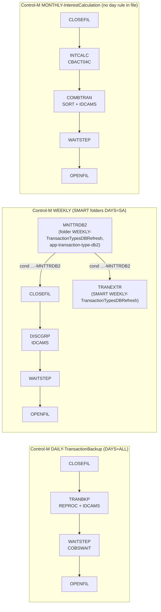
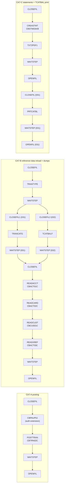
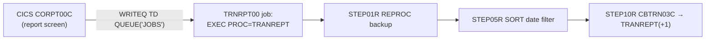

# Batch inventory: CB* programs, JCL jobs and schedules (BNP-4)

Jira: BNP-4 (subtask of BNP-2 "1.1 Inventory COBOL programs and copybooks", epic BNP-1).
Source: `ipsorakis/aws-mainframe-modernization-carddemo` @ `main` `59cc6c2`, read-only. All paths below are in that repo.
Machine-readable companion: [`batch-jobs.csv`](batch-jobs.csv), one row per JCL DD (job, step order, program, DD, DSN, DISP, program OPEN mode, scheduler membership, source line).

Conventions used here:
- `Lnn` is the line number in the cited file.
- DISP: `SHR`/`OLD` means the dataset already exists (`OLD` takes an exclusive lock). `(NEW,CATLG,DELETE)` creates it. `(MOD,DELETE,DELETE)` deletes it if it exists. `(+1)` is a new GDG generation and `(0)` is the current one.
- R/W comes from the COBOL `OPEN` mode of the program that owns the DD: INPUT = read, OUTPUT = write, I-O = read+rewrite. For utility steps it comes from the utility control statements.
- "(inferred)" marks anything that is not stated literally in the source.

Scope: the top level of `app/` only. The extension folders `app/app-authorization-ims-db2-mq/`, `app/app-transaction-type-db2/` and `app/app-vsam-mq/` exist and are out of scope. The schedulers reference only three of their jobs (CBPAUP0J, MNTTRDB2, TRANEXTR), and those are named where they appear.

## 1. Counts

| Item | Found in source | Ticket text |
|---|---|---|
| Batch COBOL programs `app/cbl/CB*` (`.cbl` + `.CBL`) | 12 (CBACT01C-04C, CBCUS01C, CBEXPORT, CBIMPORT, CBSTM03A.CBL, CBSTM03B.CBL, CBTRN01C-03C) | 12, matches |
| Batch-related utilities in `app/cbl/` | 2 (COBSWAIT is run by WAITSTEP; CSUTLDTC is a CALLed subroutine used only by online programs) | 2, but the ticket treats both as batch |
| JCL members `app/jcl/` | 38 (33 `.jcl` + 5 `.JCL`) | 29 named |
| Procedures `app/proc/` | 2 (REPROC.prc, TRANREPT.prc) | not mentioned |
| Control cards `app/ctl/` | 1 (REPROCT.ctl) | not mentioned |
| Control-M folders (`CardDemo.controlm`) | 5 definitions (3 FOLDER + 2 SMART_FOLDER) using 4 distinct names, 15 job entries, 9 distinct members (2 of them in the extension) | 4 folder names |
| CA-7 jobs (`CardDemo.ca7`) | 17 job names, 15 distinct JCL members (CLOSEFIL1/CLOSEFIL2 both use member CLOSEFIL; 14 in `app/jcl/` plus CBPAUP0J from the extension), 3 trigger chains | "job triggers" |
| JCL members run by no scheduler | 20 of 38 (section 6) | not stated |

## 2. Program-centric view

Each file is listed as DD → `SELECT` organisation/access → OPEN mode → DSN from the JCL.

| Program | Source | Function (header comment) | Run by job.step | Files read / written | Calls |
|---|---|---|---|---|---|
| CBACT01C | `app/cbl/CBACT01C.cbl` | "Read the account file and write into files" | READACCT.STEP05 (`READACCT.jcl` L32) | ACCTFILE KSDS seq, INPUT (L319): `ACCTDATA.VSAM.KSDS` OUTFILE seq, OUTPUT (L336): `ACCTDATA.PSCOMP` NEW ARRYFILE seq, OUTPUT (L354): `ACCTDATA.ARRYPS` NEW VBRCFILE seq, OUTPUT (L372): `ACCTDATA.VBPS` NEW | `COBDATFT` (L231, assembler `app/asm/COBDATFT.asm`, via copybook CODATECN); `CEE3ABD` |
| CBACT02C | `app/cbl/CBACT02C.cbl` | "Read and print card data file" | READCARD.STEP05 (L22) | CARDFILE KSDS seq, INPUT (L120): `CARDDATA.VSAM.KSDS` | CEE3ABD |
| CBACT03C | `app/cbl/CBACT03C.cbl` | "Read and print account cross reference data file" | READXREF.STEP05 (L22) | XREFFILE KSDS seq, INPUT (L120): `CARDXREF.VSAM.KSDS` | CEE3ABD |
| CBACT04C | `app/cbl/CBACT04C.cbl` | "Interest calculator" | INTCALC.STEP15 (`INTCALC.jcl` L22, `PARM='2022071800'` read through LINKAGE `PARM-DATE`, L176-180) | TCATBALF KSDS seq, INPUT (L236): `TCATBALF.VSAM.KSDS` XREFFILE KSDS random + ALTERNATE KEY FD-XREF-ACCT-ID (L34-38), INPUT (L254): `CARDXREF.VSAM.KSDS`; XREFFIL1: `CARDXREF.VSAM.AIX.PATH` (the alternate-key path DD; no SELECT of its own, inferred from the COBOL DDname+"1" convention) DISCGRP KSDS random, INPUT (L272): `DISCGRP.VSAM.KSDS` ACCTFILE KSDS random, **I-O** (L291), REWRITE L356: `ACCTDATA.VSAM.KSDS` TRANSACT seq, OUTPUT (L309), WRITE L500: `SYSTRAN(+1)` NEW | CEE3ABD |
| CBCUS01C | `app/cbl/CBCUS01C.cbl` | "Read and print customer data file" | READCUST.STEP05 (L21) | CUSTFILE KSDS seq, INPUT (L120): `CUSTDATA.VSAM.KSDS` | CEE3ABD |
| CBEXPORT | `app/cbl/CBEXPORT.cbl` | "Export Customer Data for Branch Migration" | CBEXPORT.STEP02 (L43) | INPUT (L200-228): CUSTFILE `CUSTDATA.VSAM.KSDS`, ACCTFILE `ACCTDATA.VSAM.KSDS`, XREFFILE `CARDXREF.VSAM.KSDS`, TRANSACT `TRANSACT.VSAM.KSDS`, CARDFILE `CARDDATA.VSAM.KSDS` EXPFILE KSDS, OUTPUT (L235): `EXPORT.DATA` (defined by STEP01) | CEE3ABD |
| CBIMPORT | `app/cbl/CBIMPORT.cbl` | "Import Customer Data from Branch Migration Export" | CBIMPORT.STEP01 (L22) | EXPFILE KSDS, INPUT (L198): `EXPORT.DATA` OUTPUT (L205-240), all NEW: CUSTOUT `CUSTDATA.IMPORT`, ACCTOUT `ACCTDATA.IMPORT`, XREFOUT `CARDXREF.IMPORT`, TRNXOUT `TRANSACT.IMPORT`, ERROUT `IMPORT.ERRORS` **CARDOUT** (SELECT L63, OPEN OUTPUT L233): **no DD in `CBIMPORT.jcl`** | CEE3ABD |
| CBSTM03A | `app/cbl/CBSTM03A.CBL` | "Print Account Statements from Transaction data" | CREASTMT.STEP040 (`CREASTMT.JCL` L79) | STMTFILE, HTMLFILE OUTPUT (L293): `STATEMNT.PS`, `STATEMNT.HTML` NEW Reads TRNXFILE/XREFFILE/CUSTFILE/ACCTFILE only through CBSTM03B Walks the TIOT to display DD names (L266-284) | `CBSTM03B` (13 CALLs, L351-909); CEE3ABD |
| CBSTM03B | `app/cbl/CBSTM03B.CBL` | "Does file processing related to Transact Report" | no JCL step of its own; it is a subprogram of CBSTM03A (DD chosen by `EVALUATE LK-M03B-DD`, L118-125) | TRNXFILE KSDS seq INPUT (L136): `TRXFL.VSAM.KSDS` XREFFILE KSDS seq INPUT (L160): `CARDXREF.VSAM.KSDS` CUSTFILE KSDS random INPUT (L184): `CUSTDATA.VSAM.KSDS` ACCTFILE KSDS random INPUT (L209): `ACCTDATA.VSAM.KSDS` | none |
| CBTRN01C | `app/cbl/CBTRN01C.cbl` | "Post the records from daily transaction file" | **none** (section 7) | All INPUT (L254-345): DALYTRAN seq, CUSTFILE/XREFFILE/CARDFILE/ACCTFILE/TRANFILE KSDS random. It has no WRITE or REWRITE and only DISPLAYs lookups. | CEE3ABD |
| CBTRN02C | `app/cbl/CBTRN02C.cbl` | "Post the records from daily transaction file" | POSTTRAN.STEP15 (`POSTTRAN.jcl` L23) | DALYTRAN seq INPUT (L238): `DALYTRAN.PS` TRANFILE KSDS random, **OUTPUT** (L256), WRITE L564: `TRANSACT.VSAM.KSDS` XREFFILE KSDS random INPUT (L275): `CARDXREF.VSAM.KSDS` DALYREJS seq OUTPUT (L293), WRITE L451: `DALYREJS(+1)` NEW ACCTFILE KSDS random **I-O** (L311), REWRITE L554: `ACCTDATA.VSAM.KSDS` TCATBALF KSDS random **I-O** (L329), WRITE L510 / REWRITE L528: `TCATBALF.VSAM.KSDS` | CEE3ABD |
| CBTRN03C | `app/cbl/CBTRN03C.cbl` | "Print the transaction detail report" | TRANREPT.STEP10R (`TRANREPT.jcl` L59); `app/proc/TRANREPT.prc` STEP10R (L57), submitted from CICS by CORPT00C | TRANFILE seq INPUT (L378): `TRANSACT.DALY(+1)` CARDXREF, TRANTYPE, TRANCATG KSDS random INPUT (L414-450) DATEPARM seq INPUT (L468): `DATEPARM` (or the in-stream override from CORPT00C) TRANREPT seq OUTPUT (L396), WRITE L345: `TRANREPT(+1)` NEW | CEE3ABD |
| COBSWAIT | `app/cbl/COBSWAIT.cbl` | "Utility program to wait (parm in centiseconds)" | WAITSTEP.WAIT (`WAITSTEP.jcl` L22), SYSIN `00003600` (36 s) | SYSIN (`ACCEPT ... FROM SYSIN`, L36) | `MVSWAIT` (L38, `app/asm/MVSWAIT.asm`) |
| CSUTLDTC | `app/cbl/CSUTLDTC.cbl` | date validation subroutine (`PROCEDURE DIVISION USING LS-DATE, LS-DATE-FORMAT, LS-RESULT`, L88) | **no JCL**; called by the online programs CORPT00C and COTRN02C (interface copybook `app/cpy/CSUTLDPY.cpy`) | no files | `CEEDAYS` (L116) |

All DSNs above omit the `AWS.M2.CARDDEMO.` prefix.

## 3. Job catalog (job → steps → program → DD/DSN/DISP → schedule)

Schedule keys:
- **CTM-D**: Control-M `DAILY-TransactionBackup`
- **CTM-WD**: `WEEKLY-DisclosureGroupsRefresh` (SMART folder, `DAYS="SA"`)
- **CTM-WT**: `WEEKLY-TransactionTypesDBRefresh`
- **CTM-M**: `MONTHLY-InterestCalculation`
- **CA7-A/B/C**: the CA-7 trigger chains in section 5.2

"none" means no scheduler references the job. SYSPRINT/SYSOUT/STEPLIB (`LOADLIB`) are left out here but kept in the CSV. DSN prefix `AWS.M2.CARDDEMO.` is omitted.

### 3.1 Application (COBOL) jobs

| Job (member) | # Step | Program / utility | DD → DSN (DISP), R/W | Schedule / trigger |
|---|---|---|---|---|
| POSTTRAN (`POSTTRAN.jcl`) | 1 STEP15 | CBTRN02C | DALYTRAN → `DALYTRAN.PS` (SHR) R TRANFILE → `TRANSACT.VSAM.KSDS` (SHR) W XREFFILE → `CARDXREF.VSAM.KSDS` (SHR) R DALYREJS → `DALYREJS(+1)` (NEW,CATLG,DELETE) W, LRECL 430 ACCTFILE → `ACCTDATA.VSAM.KSDS` (SHR) R/W TCATBALF → `TCATBALF.VSAM.KSDS` (SHR) R/W | CA7-A (after CBPAUP0J). Not in Control-M |
| INTCALC (`INTCALC.jcl`) | 1 STEP15 `PARM='2022071800'` | CBACT04C | TCATBALF → `TCATBALF.VSAM.KSDS` (SHR) R XREFFILE → `CARDXREF.VSAM.KSDS` (SHR) R XREFFIL1 → `CARDXREF.VSAM.AIX.PATH` (SHR) R ACCTFILE → `ACCTDATA.VSAM.KSDS` (SHR) R/W DISCGRP → `DISCGRP.VSAM.KSDS` (SHR) R TRANSACT → `SYSTRAN(+1)` (NEW,CATLG,DELETE) W, LRECL 350 | CTM-M (after CLOSEFIL) |
| TRANREPT (`TRANREPT.jcl`) | 1 STEP05R | PROC REPROC → IDCAMS REPRO (`app/ctl/REPROCT.ctl`) | PRC001.FILEIN → `TRANSACT.VSAM.KSDS` (SHR) R PRC001.FILEOUT → `TRANSACT.BKUP(+1)` (NEW,CATLG,DELETE) W | none in the schedulers. The same steps exist as PROC `app/proc/TRANREPT.prc`, which CICS program CORPT00C submits on demand via TDQ `JOBS` (CORPT00C L84-130, L517) |
| | 2 STEP05R (duplicate step name) | SORT, `INCLUDE TRAN-PROC-DT` between 2022-01-01 and 2022-07-06, sort on card number | SORTIN → `TRANSACT.BKUP(+1)` (SHR) R SORTOUT → `TRANSACT.DALY(+1)` (NEW,CATLG,DELETE) W | |
| | 3 STEP10R | CBTRN03C | TRANFILE → `TRANSACT.DALY(+1)` (SHR) R CARDXREF → `CARDXREF.VSAM.KSDS` R TRANTYPE → `TRANTYPE.VSAM.KSDS` R TRANCATG → `TRANCATG.VSAM.KSDS` R DATEPARM → `DATEPARM` (SHR) R TRANREPT → `TRANREPT(+1)` (NEW,CATLG,DELETE) W, LRECL 133 | |
| CREASTMT (`CREASTMT.JCL`) | 1 DELDEF01 | IDCAMS | DELETE `TRXFL.SEQ`, `TRXFL.VSAM.KSDS`; DEFINE `TRXFL.VSAM.KSDS` KEYS(32 0) RECORDSIZE(350 350) | CA7-C (after CLOSEFIL, triggers TXT2PDF1) |
| | 2 STEP010 | SORT, `SORT FIELDS=(263,16,CH,A,1,16,CH,A)`, OUTREC moves the card number to the front | SORTIN → `TRANSACT.VSAM.KSDS` (SHR) R SORTOUT → `TRXFL.SEQ` (NEW,CATLG,DELETE) W | |
| | 3 STEP020 COND=(0,NE) | IDCAMS REPRO | INFILE → `TRXFL.SEQ` (SHR) R OUTFILE → `TRXFL.VSAM.KSDS` (SHR) W | |
| | 4 STEP030 COND=(0,NE) | IEFBR14 | HTMLFILE → `STATEMNT.HTML` (MOD,DELETE,DELETE) STMTFILE → `STATEMNT.PS` (MOD,DELETE,DELETE) | |
| | 5 STEP040 COND=(0,NE) | CBSTM03A (+CBSTM03B) | TRNXFILE → `TRXFL.VSAM.KSDS` R XREFFILE → `CARDXREF.VSAM.KSDS` R ACCTFILE → `ACCTDATA.VSAM.KSDS` R CUSTFILE → `CUSTDATA.VSAM.KSDS` R (all SHR) STMTFILE → `STATEMNT.PS` (NEW,CATLG,DELETE) W, LRECL 80 HTMLFILE → `STATEMNT.HTML` (NEW,CATLG,DELETE) W, LRECL 100 | |
| READACCT (`READACCT.jcl`) | 1 PREDEL | IEFBR14 | DD01-03 → `ACCTDATA.PSCOMP`, `ACCTDATA.ARRYPS`, `ACCTDATA.VBPS` (MOD,DELETE,DELETE) | CA7-B (after CLOSEFIL, triggers READCARD) |
| | 2 STEP05 | CBACT01C | ACCTFILE → `ACCTDATA.VSAM.KSDS` (SHR) R OUTFILE → `ACCTDATA.PSCOMP` W ARRYFILE → `ACCTDATA.ARRYPS` W VBRCFILE → `ACCTDATA.VBPS` W (all three NEW,CATLG,DELETE) | |
| READCARD (`READCARD.jcl`) | 1 STEP05 | CBACT02C | CARDFILE → `CARDDATA.VSAM.KSDS` (SHR) R | CA7-B (after READACCT, triggers READCUST) |
| READCUST (`READCUST.jcl`) | 1 STEP05 | CBCUS01C | CUSTFILE → `CUSTDATA.VSAM.KSDS` (SHR) R | CA7-B (after READCARD, triggers READXREF) |
| READXREF (`READXREF.jcl`) | 1 STEP05 | CBACT03C | XREFFILE → `CARDXREF.VSAM.KSDS` (SHR) R | CA7-B (after READCUST, triggers WAITSTEP) |
| CBEXPORT (`CBEXPORT.jcl`) | 1 STEP01 | IDCAMS | DELETE/DEFINE `EXPORT.DATA` KSDS KEYS(4 28) RECORDSIZE(500 500) | none |
| | 2 STEP02 | CBEXPORT | CUSTFILE, ACCTFILE, XREFFILE, TRANSACT, CARDFILE → `*.VSAM.KSDS` (SHR) R EXPFILE → `EXPORT.DATA` (SHR) W | |
| CBIMPORT (`CBIMPORT.jcl`) | 1 STEP01 | CBIMPORT | EXPFILE → `EXPORT.DATA` (SHR) R CUSTOUT → `CUSTDATA.IMPORT`, ACCTOUT → `ACCTDATA.IMPORT`, XREFOUT → `CARDXREF.IMPORT`, TRNXOUT → `TRANSACT.IMPORT`, ERROUT → `IMPORT.ERRORS` (all NEW,CATLG,DELETE) W CARDOUT: missing | none |
| WAITSTEP (`WAITSTEP.jcl`) | 1 WAIT | COBSWAIT | SYSIN in-stream `00003600` | CTM-D, CTM-WD, CTM-M, CA7-A/B/C |

### 3.2 CICS file control jobs (SDSF → `CEMT SET FIL`)

| Job (member) | # Step | Program / utility | Effect | Schedule / trigger |
|---|---|---|---|---|
| CLOSEFIL (`CLOSEFIL.jcl`) | 1 CLCIFIL | SDSF (ISFIN in-stream) | `/F CICSAWSA,'CEMT SET FIL(x) CLO'` for TRANSACT, CCXREF, ACCTDAT, CXACAIX, USRSEC | first job of CTM-D, CTM-WD, CTM-M; CA7-A/B/C (also as CA-7 jobs CLOSEFIL1/CLOSEFIL2) |
| OPENFIL (`OPENFIL.jcl`) | 1 OPCIFIL | SDSF | the same 5 files `... OPE` | last job of CTM-D, CTM-WD, CTM-M; CA7-A/B/C |

### 3.3 VSAM define/load jobs (IDCAMS; keys and record sizes from the DEFINEs)

| Job (member) | Steps (in order) | Datasets (DISP) | Schedule / trigger |
|---|---|---|---|
| ACCTFILE | STEP05 IDCAMS DELETE → STEP10 DEFINE `ACCTDATA.VSAM.KSDS` KEYS(11 0) RECSZ(300) → STEP15 REPRO | ACCTDATA ← `ACCTDATA.PS` (SHR) R; ACCTVSAM → `ACCTDATA.VSAM.KSDS` (SHR) W | none |
| CARDFILE | CLCIFIL SDSF close CARDDAT/CARDAIX → STEP05 DELETE KSDS+AIX → STEP10 DEFINE `CARDDATA.VSAM.KSDS` KEYS(16 0) RECSZ(150) → STEP15 REPRO → STEP40 DEFINE AIX KEYS(11 16) NONUNIQUE → STEP50 DEFINE PATH `CARDDATA.VSAM.AIX.PATH` → STEP60 BLDINDEX → OPCIFIL SDSF open | CARDDATA ← `CARDDATA.PS` (SHR) R; CARDVSAM → `CARDDATA.VSAM.KSDS` (SHR) W | none |
| CUSTFILE | CLCIFIL close CUSTDAT → STEP05 DELETE → STEP10 DEFINE `CUSTDATA.VSAM.KSDS` KEYS(9 0) RECSZ(500) → STEP15 REPRO → OPCIFIL open | CUSTDATA ← `CUSTDATA.PS` (SHR) R; CUSTVSAM → `CUSTDATA.VSAM.KSDS` (SHR) W | none |
| XREFFILE | STEP05 DELETE KSDS+AIX → STEP10 DEFINE `CARDXREF.VSAM.KSDS` KEYS(16 0) RECSZ(50) → STEP15 REPRO → STEP20 DEFINE AIX KEYS(11,25) NONUNIQUE → STEP25 PATH `CARDXREF.VSAM.AIX.PATH` → STEP30 BLDINDEX | XREFDATA ← `CARDXREF.PS` (SHR) R; XREFVSAM → `CARDXREF.VSAM.KSDS` (SHR) W | none |
| TRANFILE | CLCIFIL close TRANSACT/CXACAIX → STEP05 DELETE KSDS+AIX → STEP10 DEFINE `TRANSACT.VSAM.KSDS` KEYS(16 0) RECSZ(350) → STEP15 REPRO → STEP20 DEFINE AIX KEYS(26 304) NONUNIQUE → STEP25 PATH → STEP30 BLDINDEX → OPCIFIL open | TRANSACT ← `DALYTRAN.PS.INIT` (SHR) R; TRANVSAM → `TRANSACT.VSAM.KSDS` (SHR) W | none |
| TRANIDX | STEP20 DEFINE AIX `TRANSACT.VSAM.AIX` KEYS(26 304) → STEP25 DEFINE PATH `TRANSACT.VSAM.AIX.PATH` → STEP30 BLDINDEX | catalog only | none |
| TCATBALF | STEP05 DELETE → STEP10 DEFINE `TCATBALF.VSAM.KSDS` KEYS(17 0) RECSZ(50) → STEP15 REPRO | TCATBAL ← `TCATBALF.PS` (SHR) R; TCATBALV → `TCATBALF.VSAM.KSDS` (OLD) W | CA7-B (after CLOSEFIL2, triggers WAITSTEP) |
| TRANCATG | STEP05 DELETE → STEP10 DEFINE `TRANCATG.VSAM.KSDS` KEYS(6 0) RECSZ(60) → STEP15 REPRO | TRANCATG ← `TRANCATG.PS` (SHR) R; TCATVSAM → `TRANCATG.VSAM.KSDS` (OLD) W | CA7-B (after CLOSEFIL1, triggers WAITSTEP) |
| TRANTYPE | STEP05 DELETE → STEP10 DEFINE `TRANTYPE.VSAM.KSDS` KEYS(2 0) RECSZ(60) → STEP15 REPRO | TRANTYPE ← `TRANTYPE.PS` (SHR) R; TTYPVSAM → `TRANTYPE.VSAM.KSDS` (OLD) W | CA7-B (after CLOSEFIL, triggers WAITSTEP) |
| DISCGRP | STEP05 DELETE → STEP10 DEFINE `DISCGRP.VSAM.KSDS` KEYS(16 0) RECSZ(50) → STEP15 REPRO | DISCGRP ← `DISCGRP.PS` (SHR) R; DISCVSAM → `DISCGRP.VSAM.KSDS` (OLD) W | CTM-WD (after CLOSEFIL) |
| DUSRSECJ | PREDEL IEFBR14 → STEP01 IEBGENER (in-stream 10 user records) → STEP02 DELETE/DEFINE `USRSEC.VSAM.KSDS` KEYS(8,0) RECSZ(80) → STEP03 REPRO | DD01 `USRSEC.PS` (MOD,DELETE,DELETE); SYSUT2 → `USRSEC.PS` (NEW,CATLG,DELETE) W; IN ← `USRSEC.PS` (SHR) R; OUT → `USRSEC.VSAM.KSDS` (SHR) W | none |
| ESDSRRDS | PREDEL → STEP01 IEBGENER → STEP02 DEFINE `USRSEC.VSAM.ESDS` NONINDEXED → STEP03 REPRO → STEP04 DEFINE `USRSEC.VSAM.RRDS` NUMBERED → STEP05 REPRO | `ESDSRRDS.PS` (NEW then SHR) → `USRSEC.VSAM.ESDS`, `USRSEC.VSAM.RRDS` (SHR) W | none |
| DEFCUST | STEP05 IDCAMS DELETE `AWS.CCDA.CUSTDATA.CLUSTER` → STEP05 (duplicate step name) DEFINE `AWS.CUSTDATA.CLUSTER` KEYS(10 0) RECSZ(500) | catalog only. These names are outside the `AWS.M2.CARDDEMO` HLQ and no program DD points at them | none |
| TRANBKP | STEP05R PROC REPROC (IDCAMS REPRO) → STEP05 IDCAMS DELETE `TRANSACT.VSAM.KSDS` + `TRANSACT.VSAM.AIX` → STEP10 COND=(4,LT) DEFINE `TRANSACT.VSAM.KSDS` KEYS(16 0) RECSZ(350) (empty, AIX not redefined) | PRC001.FILEIN ← `TRANSACT.VSAM.KSDS` (SHR) R; PRC001.FILEOUT → `TRANSACT.BKUP(+1)` (NEW,CATLG,DELETE) W | CTM-D (after CLOSEFIL) |
| COMBTRAN | STEP05R SORT `SORT FIELDS=(TRAN-ID,A)` → STEP10 IDCAMS REPRO | SORTIN ← `TRANSACT.BKUP(0)` + `SYSTRAN(0)` (concatenated, SHR) R; SORTOUT → `TRANSACT.COMBINED(+1)` (NEW,CATLG,DELETE) W; TRANSACT ← `TRANSACT.COMBINED(+1)` R; TRANVSAM → `TRANSACT.VSAM.KSDS` (SHR) W | CTM-M (after INTCALC) |
| PRTCATBL | DELDEF IEFBR14 → STEP05R PROC REPROC → STEP10R SORT (by acct/type/cat, OUTREC with edited balance) | THEFILE `TCATBALF.REPT` (MOD,DELETE); FILEIN ← `TCATBALF.VSAM.KSDS` R; FILEOUT → `TCATBALF.BKUP(+1)` NEW W; SORTIN ← `TCATBALF.BKUP(+1)` R; SORTOUT → `TCATBALF.REPT` NEW W | CA7-C (after CLOSEFIL SCHID 031, triggers WAITSTEP) |

### 3.4 GDG base definitions

| Job | GDG bases (LIMIT, options) | Schedule |
|---|---|---|
| DEFGDGB | `TRANSACT.BKUP`, `TRANSACT.DALY`, `TRANREPT`, `TCATBALF.BKUP`, `SYSTRAN`, `TRANSACT.COMBINED`, each LIMIT(5) SCRATCH | none |
| DEFGDGD | STEP10 `TRANTYPE.BKUP` → STEP20 IEBGENER `TRANTYPE.PS` → `TRANTYPE.BKUP(+1)` (NEW,CATLG); STEP30 `TRANCATG.PS.BKUP` → STEP40 IEBGENER `TRANCATG.PS` → `TRANCATG.PS.BKUP(+1)`; STEP50 `DISCGRP.BKUP` → STEP60 IEBGENER `DISCGRP.PS` → `DISCGRP.BKUP(+1)`, each LIMIT(5) SCRATCH | none |
| DALYREJS | `DALYREJS` LIMIT(5) SCRATCH | none |
| REPTFILE | `TRANREPT` LIMIT(10), no SCRATCH, which conflicts with DEFGDGB | none |

### 3.5 Other utility jobs

| Job (member) | Steps | Datasets | Schedule |
|---|---|---|---|
| CBADMCDJ | STEP1 DFHCSDUP `PARM='CSD(READWRITE),...'` | DFHCSD → `OEM.CICSTS.DFHCSD` (SHR); in-stream CEDA DEFINEs for group CARDDEMO (LIBRARY, MAPSETs, PROGRAMs, TRANSACTIONs) | none |
| TXT2PDF1 (`TXT2PDF1.JCL`) | TXT2PDF IKJEFT1B COND=(0,NE), REXX `%TXT2PDF` | INDD ← `STATEMNT.PS` (SHR) R; output `AWS.M2.CARDDEMO.STATEMNT.PS.PDF`; STEPLIB/SYSEXEC `AWS.M2.LBD.TXT2PDF.*` | CA7-C (after CREASTMT) |
| FTPJCL (`FTPJCL.JCL`, JOB card name `FTPJCLS`) | STEP1 PGM=FTP | in-stream FTP script PUTs `AWS.M2.CARDEMO.FTP.TEST` (note "CARDEMO"). The script holds a host, user ID and password in plain text; not reproduced here | none |
| INTRDRJ1 (`INTRDRJ1.JCL`) | IDCAMS REPRO → STEP01 IEBGENER | IN `AWS.M2.CARDEMO.FTP.TEST` → OUT `...FTP.TEST.BKUP` (SHR); SYSUT1 `AWS.M2.CARDDEMO.JCL(INTRDRJ2)` → SYSUT2 `SYSOUT=(A,INTRDR)`, which submits INTRDRJ2 | none |
| INTRDRJ2 (`INTRDRJ2.JCL`) | IDCAMS REPRO | IN `AWS.M2.CARDEMO.FTP.TEST.BKUP` → OUT `...FTP.TEST.BKUP.INTRDR` (SHR) | submitted only by INTRDRJ1 via the internal reader |

### 3.6 Procedures and control members

| Member | Defines | Used by |
|---|---|---|
| `app/proc/REPROC.prc` | `//REPROC PROC`, step PRC001 IDCAMS. FILEIN/FILEOUT default to `NULLFILE` and are overridden by callers; SYSIN `&CNTLLIB(REPROCT)` | TRANBKP, TRANREPT, PRTCATBL (`JCLLIB ORDER=('AWS.M2.CARDDEMO.PROC')`), and TRANREPT.prc |
| `app/ctl/REPROCT.ctl` | `REPRO INFILE(FILEIN) OUTFILE(FILEOUT)` | REPROC via `CNTLLIB=AWS.M2.CARDDEMO.CNTL` |
| `app/proc/TRANREPT.prc` | The PROC statement on L1 is named `REPROC`, not TRANREPT. Steps STEP01R (nested REPROC), STEP05R SORT, STEP10R CBTRN03C, the same as TRANREPT.jcl | CICS CORPT00C: in-memory JCL `//STEP10 EXEC PROC=TRANREPT` with `STEP05R.SYMNAMES` and `STEP10R.DATEPARM` overrides, written to TDQ `JOBS` (CORPT00C L84-130, L515-518) |

## 4. Dataset lineage of the core cycle (from the DDs above)

- `DALYTRAN.PS` (sample in `app/data/EBCDIC/AWS.M2.CARDDEMO.DALYTRAN.PS`) → **POSTTRAN/CBTRN02C** → appends to `TRANSACT.VSAM.KSDS` and updates `ACCTDATA` and `TCATBALF`; rejects go to `DALYREJS(+1)`.
- **TRANBKP** copies `TRANSACT.VSAM.KSDS` → `TRANSACT.BKUP(+1)`, then deletes and redefines the KSDS empty.
- **INTCALC/CBACT04C** reads `TCATBALF`, `CARDXREF` (+AIX path) and `DISCGRP`, rewrites `ACCTDATA`, and writes interest transactions to `SYSTRAN(+1)`.
- **COMBTRAN** sorts `TRANSACT.BKUP(0)` + `SYSTRAN(0)` → `TRANSACT.COMBINED(+1)` and REPROs that into `TRANSACT.VSAM.KSDS`.
- **CREASTMT** sorts `TRANSACT.VSAM.KSDS` → `TRXFL` and has CBSTM03A/B write `STATEMNT.PS`/`.HTML`. **TXT2PDF1** turns `STATEMNT.PS` into a PDF.
- **TRANREPT** (on demand) copies `TRANSACT.VSAM.KSDS` → `TRANSACT.BKUP(+1)`, date-filters it to `TRANSACT.DALY(+1)`, and CBTRN03C writes `TRANREPT(+1)`.

The source does not order these jobs end-to-end in one scheduler. The README's "Running Batch Jobs" table (`README.md` L207-232) lists a manual sequence: CLOSEFIL, the loads, POSTTRAN, INTCALC, TRANBKP, COMBTRAN, CREASTMT, TRANIDX, OPENFIL.

## 5. Schedules

### 5.1 Control-M (`app/scheduler/CardDemo.controlm`)

| Folder (type, REAL_FOLDER_ID) | Folder rule | Jobs in JOBISN order, with IN → OUT conditions | Job-level rule |
|---|---|---|---|
| `DAILY-TransactionBackup` (FOLDER, 1) | none | 1 CLOSEFIL → +`…-CLOSEFIL`; 2 TRANBKP (in `…-CLOSEFIL`); 3 WAITSTEP (in `…-TRANBKP`); 4 OPENFIL (in `…-WAITSTEP`). Each job deletes (-) its input condition | `DAYS="ALL"`, `TIMETO="23:00"` |
| `WEEKLY-TransactionTypesDBRefresh` (FOLDER, 2) | none | 1 MNTTRDB2 (member in `app/app-transaction-type-db2/jcl/`) → +`WEEKLY-TransactionTypesDBRefresh-MNTTRDB2` | no DAYS; `TIMETO="23:00"` |
| `WEEKLY-DisclosureGroupsRefresh` (SMART_FOLDER, 3) | `DAYS="SA"` (Saturday) | 1 CLOSEFIL (in `WEEKLY-TransactionTypesDBRefresh-MNTTRDB2`); 2 DISCGRP; 3 WAITSTEP; 4 OPENFIL. At folder end it deletes `…-MNTTRDB2` | no DAYS; `TIMETO="23:00"` |
| `WEEKLY-TransactionTypesDBRefresh` (SMART_FOLDER, 4; same name as folder 2) | `DAYS="SA"`, `INTERVAL="00005M"` | 1 TRANEXTR (member in `app/app-transaction-type-db2/jcl/`; in `…-MNTTRDB2`; its `PARENT_FOLDER` attribute says `WEEKLY-DisclosureGroupsRefresh`). At folder end it deletes `…-MNTTRDB2` | no DAYS; `TIMETO="23:00"` |
| `MONTHLY-InterestCalculation` (FOLDER, 5) | none | 1 CLOSEFIL; 2 INTCALC; 3 COMBTRAN; 4 WAITSTEP; 4 OPENFIL (two jobs with JOBISN=4) | no DAYS/MONTHDAYS: "monthly" comes from the folder name only; `TIMETO="23:00"` |

### 5.2 CA-7 (`app/scheduler/CardDemo.ca7`)

The file is an `LJOB,LIST=ALL` listing. It holds job definitions and **TRIGGERED JOBS** (job-completion triggers) with SCHID 030/031/032 and `QTM=0100`. It has no calendars or date/time schedules, so the CA-7 frequency is not defined in the source. Every job shows `JCLLIB=&CARDDEMOPRODJCL`, "JOB MARKED AS MAINT ONLY = Y" and "DONT SCHEDULE BEFORE 03237". CLOSEFIL1 and CLOSEFIL2 are CA-7 job names that both run member CLOSEFIL (L225, L252).

| Chain | Trigger sequence (file lines) |
|---|---|
| CA7-A | CLOSEFIL (L18) → CBPAUP0J (L43, extension `app/app-authorization-ims-db2-mq/jcl/CBPAUP0J.jcl`) → POSTTRAN (L70) → WAITSTEP (L97) → OPENFIL (L124). All SCHID 030 |
| CA7-B | CLOSEFIL (L159) → TRANTYPE (L162) → WAITSTEP (L189) → **CLOSEFIL1** SCHID 031 and **CLOSEFIL2** SCHID 032 (L216-217). CLOSEFIL1 → TRANCATG (L244) → WAITSTEP 031 (L298) → CLOSEFIL 030 (L303). CLOSEFIL2 → TCATBALF (L271) → WAITSTEP 032 (L330) → CLOSEFIL 030 (L335). Then CLOSEFIL → READACCT (L340) → READCARD (L367) → READCUST (L394) → READXREF (L421) → WAITSTEP (L448) → OPENFIL (L453) |
| CA7-C | CLOSEFIL (L465) → CREASTMT (L468) → TXT2PDF1 (L495) → WAITSTEP (L522) → OPENFIL (L527) → CLOSEFIL SCHID 031 (L532) → PRTCATBL (L537) → WAITSTEP 031 (L564) → OPENFIL 031 (L569) |

Both trigger paths in CA7-B end in a trigger of CLOSEFIL (SCHID 030). The listing does not say whether CA-7 waits for both or runs the tail twice (inferred: ambiguous).

### 5.3 On-demand (CICS-submitted)

## 6. Jobs not referenced by any scheduler

Of the 38 `app/jcl/` members, 18 appear in at least one scheduler and **20 appear in neither**:

ACCTFILE, CARDFILE, CBADMCDJ, CBEXPORT, CBIMPORT, CUSTFILE, DALYREJS, DEFCUST, DEFGDGB, DEFGDGD, DUSRSECJ, ESDSRRDS, FTPJCL, INTRDRJ1, INTRDRJ2 (submitted by INTRDRJ1 via the internal reader), REPTFILE, TRANFILE, TRANIDX, TRANREPT (submitted on demand from CICS as PROC TRANREPT), XREFFILE.

Scheduled members and where they appear:

| Member | Control-M | CA-7 |
|---|---|---|
| CLOSEFIL, OPENFIL, WAITSTEP | yes | yes |
| TRANBKP, DISCGRP, INTCALC, COMBTRAN | yes | no |
| POSTTRAN, TRANTYPE, TRANCATG, TCATBALF, READACCT, READCARD, READCUST, READXREF, CREASTMT, TXT2PDF1, PRTCATBL | no | yes |

## 7. CBTRN01C: not invoked

- No `EXEC PGM=CBTRN01C` exists in `app/jcl/`, `app/proc/`, or in the in-stream JCL inside CORPT00C. Neither scheduler references it, and it is not in `app/csd/CARDDEMO.CSD` or `CBADMCDJ.jcl`. `README.md` does not mention it. Checked with `git grep -i CBTRN01C`: the only non-source hits are binaries.
- The only other artefacts are a compiled module `loadlib/CBTRN01C.so` in `samples/m2/mf/CardDemo_runtime.zip` and a source copy `migrated_app/cbl/CBTRN01C.cbl` in `samples/m2/unikix/UniKix_CardDemo_runtime_v1.zip`. Neither archive contains JCL that runs it.
- Behaviour: it opens DALYTRAN, CUSTFILE, XREFFILE, CARDFILE, ACCTFILE and TRANFILE, all INPUT (L254-345). It reads each daily transaction, looks up XREF and ACCOUNT, and only DISPLAYs the results (L156-195, L229-249). It has no WRITE or REWRITE.
- **Flag: unreferenced by any JCL or scheduler.** It looks like a dry-run/validation predecessor of CBTRN02C (same header text "Post the records from daily transaction file") (inferred). Running it would need POSTTRAN's DDs plus CUSTFILE and CARDFILE (inferred).

## 8. Source anomalies worth knowing for the port (verified)

1. **CBIMPORT.jcl lacks the CARDOUT DD.** CBIMPORT.cbl opens `CARD-OUTPUT ASSIGN TO CARDOUT` OUTPUT (L63, L233), so the OPEN would fail and the error DISPLAY at L235 would fire (inferred runtime effect).
2. INTCALC hard-codes `PARM='2022071800'`. TRANREPT.jcl and TRANREPT.prc hard-code the SORT date window 2022-01-01 to 2022-07-06. `AWS.M2.CARDDEMO.DATEPARM` is not created by any job in `app/jcl/`.
3. TRANREPT.jcl has two steps named `STEP05R` (L23, L37). DEFCUST has two steps named `STEP05` (L22, L32), and it deletes `AWS.CCDA.CUSTDATA.CLUSTER` but defines `AWS.CUSTDATA.CLUSTER` with KEYS(10 0), against KEYS(9 0) in CUSTFILE.
4. `app/proc/TRANREPT.prc` declares `//REPROC PROC` (L1) and nests `EXEC PROC=REPROC`.
5. GDG `AWS.M2.CARDDEMO.TRANREPT` is defined twice: DEFGDGB LIMIT(5) SCRATCH and REPTFILE LIMIT(10).
6. TRANBKP deletes `TRANSACT.VSAM.AIX` but recreates only the base cluster. TRANIDX (or TRANFILE) rebuilds the AIX/PATH, and neither is scheduled.
7. CBTRN02C opens the TRANSACT KSDS as OUTPUT (random access) to add posted transactions (L256, L564).
8. README says CLOSEFIL/OPENFIL run IEFBR14 (`README.md` L313, L318, "Batch Components" table). They actually run `PGM=SDSF` with `CEMT SET FIL` commands. README also lists MNTTRDB2/TRANEXTR, which live in the Db2 extension.
9. Control-M: the MONTHLY folder has no run-day rule, MONTHLY has duplicate JOBISN=4, the name `WEEKLY-TransactionTypesDBRefresh` is used twice, and TRANEXTR has an inconsistent `PARENT_FOLDER`. Every job has `TIMETO="23:00"` and no `TIMEFROM`.
10. POSTTRAN (daily posting) and CREASTMT appear only in CA-7. INTCALC, COMBTRAN, TRANBKP and DISCGRP appear only in Control-M. The two schedulers model different subsets and do not form one consistent calendar.
11. FTPJCL.JCL holds plain-text FTP credentials in-stream. Treat this as a security finding and do not migrate it as-is.

## 9. Differences from ticket

| Ticket text | Source reality |
|---|---|
| Batch programs "CBACT01C–04C, CBCUS01C, CBTRN01C–03C, CBSTM03A/CBSTM03B (.CBL), CBIMPORT, CBEXPORT; plus CSUTLDTC, COBSWAIT" | All 14 exist. **CSUTLDTC is not a batch program**: no JCL runs it, and online programs CORPT00C and COTRN02C CALL it. CBSTM03B has no job step; CBSTM03A CALLs it |
| JCL→program mapping names 12 jobs and a utility list of 17 (29 of 38) | 9 members are missing from the ticket: **CBADMCDJ, DEFCUST, ESDSRRDS, FTPJCL.JCL, INTRDRJ1.JCL, INTRDRJ2.JCL, PRTCATBL, REPTFILE, TXT2PDF1.JCL**. All are catalogued above |
| "TRANREPT→CBTRN03C (+SORT)" | It also has a REPROC/IDCAMS backup step first. TRANREPT is in no scheduler: CICS CORPT00C submits it on demand through `PROC=TRANREPT` |
| "CREASTMT.JCL→CBSTM03A (calls CBSTM03B)" | Correct. It also has IDCAMS, SORT, IDCAMS REPRO and IEFBR14 steps before CBSTM03A |
| "OPENFIL/CLOSEFIL" in the IDCAMS/utility list | They run SDSF (`CEMT SET FIL ... OPE/CLO`), not IDCAMS |
| `app/proc/` not mentioned ("if JCL references PROCs") | `app/proc/REPROC.prc` is used by TRANBKP, TRANREPT and PRTCATBL. `app/proc/TRANREPT.prc` is used by CORPT00C. `app/ctl/REPROCT.ctl` holds the REPRO card |
| Control-M folders: 4 names | 5 folder definitions. `WEEKLY-TransactionTypesDBRefresh` appears as both a FOLDER (MNTTRDB2) and a SMART_FOLDER (TRANEXTR). Both jobs, and CA-7's CBPAUP0J, are extension members outside `app/jcl/` |
| Flow diagram of "nightly/weekly/monthly chains" | Control-M has no nightly posting chain: DAILY is backup only. Daily posting (POSTTRAN) exists only as CA-7 trigger chain A, and CA-7 carries no calendar. MONTHLY has no day rule. WEEKLY = Saturday (`DAYS="SA"`) |
| "CBTRN01C has no JCL member" | Confirmed, and also nothing else invokes it (section 7) |

## 10. How this was verified

- File lists come from `git ls-files app/cbl app/jcl app/proc app/ctl app/scheduler` at `59cc6c2`.
- JCL was parsed by a script: statements, EXEC PGM/PROC, DD/DSN/DISP and in-stream SYSIN. That script generated `batch-jobs.csv`.
- Control-M was parsed as XML. CA-7 was parsed with regexes for `LJOB` and `JOB=… SCHID=`.
- A cross-check script confirms:
  - every `app/jcl/*` member and every `app/cbl/CB*` program, plus COBSWAIT and CSUTLDTC, is named in this document;
  - every `EXEC PGM=` program in the JCL appears in the matching job's row;
  - each COBOL `SELECT … ASSIGN TO` DD name exists as a DD in the JCL step that runs the program. The only miss is CBIMPORT's CARDOUT; CBSTM03B's DDs are supplied through CBSTM03A's step;
  - every scheduler job name appears in this document.
