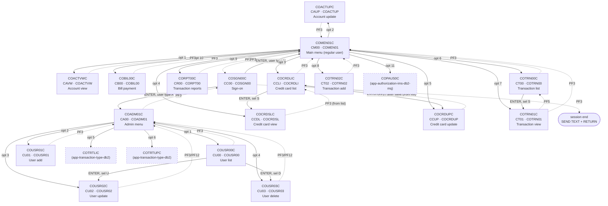

# BNP-3: Online CICS programs and BMS maps inventory

Source: `ipsorakis/aws-mainframe-modernization-carddemo` @ `59cc6c2` (`main`), read-only. Scope: `app/` top level only (`app/cbl/CO*.cbl`, `app/bms/`, `app/cpy-bms/`, `app/csd/`, `app/cpy/COCOM01Y.cpy`, `app/cpy/COMEN02Y.cpy`, `app/cpy/COADM02Y.cpy`). Everything below is taken from those files; paragraph names and line numbers refer to the source repo. Statements marked *(inferred)* are reasoning, not something the source states directly.

The extension folders (`app/app-authorization-ims-db2-mq/`, `app/app-transaction-type-db2/`, `app/app-vsam-mq/`) have their own online programs/maps and are out of scope here; they matter only because the menu tables point at three of their programs (see [Menu option tables](#menu-option-tables)).

Machine-readable companion: [`online-screens.csv`](online-screens.csv) lists every `DFHMDF` field of every map (named and literal).

## Contents

- [Counts](#counts)
- [Summary](#summary)
- [CSD transaction definitions](#csd-transaction-definitions)
- [COMMAREA (COCOM01Y)](#commarea-cocom01y)
- [Menu option tables](#menu-option-tables)
- [Navigation diagram](#navigation-diagram)
- [Program details](#program-details)
- [Screen field lists](#screen-field-lists)
- [Differences from ticket](#differences-from-ticket)
- [Source observations](#source-observations)
- [Out of scope: COBSWAIT](#out-of-scope-cobswait)
- [How this was verified](#how-this-was-verified)

## Counts

| Item | Found in source | Ticket BNP-3 |
|---|---|---|
| `app/cbl/CO*.cbl` files | 18 (17 online + COBSWAIT batch) | 17 online listed + COBSWAIT noted as batch |
| `app/bms/*.bms` mapsets | 17 (1 map each, 17 maps) | 17 listed |
| `app/cpy-bms/` symbolic map copybooks | 17 `.CPY` (+ `.gitkeep`) | not counted |
| `app/csd/` files | 1 (`CARDDEMO.CSD`, + `.gitkeep`) | not counted |
| CSD `DEFINE TRANSACTION` | 18 | not counted |
| CSD `DEFINE PROGRAM` | 18 | not counted |
| CSD `DEFINE MAPSET` | 17 | not counted |
| `DFHMDF` fields (all maps) | 902 (441 named / symbolic, 461 unnamed literals) | not counted |
| COMEN02Y user-menu options | 11 (`CDEMO-MENU-OPT-COUNT` = 11, `OCCURS 12`) | not counted |
| COADM02Y admin-menu options | 6 (`CDEMO-ADMIN-OPT-COUNT` = 6, `OCCURS 9`) | not counted |

## Summary

PF keys = keys the program actually acts on (from its `EVALUATE EIBAID` or `CCARD-AID-*` tests); the map legend is the key text painted on the screen by the BMS map. "Next program(s)" = static `XCTL` targets; `(CDEMO-FROM-PROGRAM)` means PF3 returns to whichever program called it. Every program ends its pseudo-conversational turn with `EXEC CICS RETURN TRANSID(<own transid>) COMMAREA(...)`. No program uses `EXEC CICS LINK` or `START`.

| Program | Function | Transid (CSD) | Mapset / map | PF keys handled | Map legend | Next program(s) via XCTL | VSAM / queues |
|---|---|---|---|---|---|---|---|
| [COACTUPC](#coactupc) | Account update | CAUP | COACTUP / CACTUPA | ENTER, PF3, PF5, PF12 | ENTER=Process F3=Exit F5=Save F12=Cancel | COMEN01C, (CDEMO-FROM-PROGRAM) | CXACAIX, ACCTDAT, CUSTDAT (READ); ACCTDAT, CUSTDAT (REWRITE) |
| [COACTVWC](#coactvwc) | Account view | CAVW | COACTVW / CACTVWA | ENTER, PF3 | F3=Exit | COMEN01C, (CDEMO-FROM-PROGRAM) | CXACAIX, ACCTDAT, CUSTDAT (READ) |
| [COADM01C](#coadm01c) | Admin menu | CA00 | COADM01 / COADM1A | ENTER, PF3 | ENTER=Continue F3=Exit | COSGN00C, COUSR00C, COUSR01C, COUSR02C, COUSR03C, COTRTLIC, COTRTUPC | none (WS-USRSEC-FILE literal declared, not used) |
| [COBIL00C](#cobil00c) | Bill payment | CB00 | COBIL00 / COBIL0A | ENTER, PF3, PF4 | ENTER=Continue F3=Back F4=Clear | COSGN00C, COMEN01C, (CDEMO-FROM-PROGRAM) | ACCTDAT (READ, REWRITE), CXACAIX (READ), TRANSACT (STARTBR/READPREV/ENDBR, WRITE) |
| [COCRDLIC](#cocrdlic) | Credit card list | CCLI | COCRDLI / CCRDLIA | ENTER, PF3, PF7, PF8 | F3=Exit F7=Backward F8=Forward | COMEN01C, COCRDSLC, COCRDUPC | CARDDAT (STARTBR/READNEXT/READPREV) |
| [COCRDSLC](#cocrdslc) | Credit card view | CCDL | COCRDSL / CCRDSLA | ENTER, PF3 | ENTER=Search Cards F3=Exit | COMEN01C, COCRDLIC, (CDEMO-FROM-PROGRAM) | CARDDAT, CARDAIX (READ) |
| [COCRDUPC](#cocrdupc) | Credit card update | CCUP | COCRDUP / CCRDUPA | ENTER, PF3, PF5, PF12 | ENTER=Process F3=Exit F5=Save F12=Cancel | COMEN01C, COCRDLIC, (CDEMO-FROM-PROGRAM) | CARDDAT (READ, REWRITE) |
| [COMEN01C](#comen01c) | Main menu (regular user) | CM00 | COMEN01 / COMEN1A | ENTER, PF3 | ENTER=Continue F3=Exit | COSGN00C, COACTVWC, COACTUPC, COCRDLIC, COCRDSLC, COCRDUPC, COTRN00C, COTRN01C, COTRN02C, CORPT00C, COBIL00C, COPAUS0C | none (WS-USRSEC-FILE literal declared, not used) |
| [CORPT00C](#corpt00c) | Transaction reports | CR00 | CORPT00 / CORPT0A | ENTER, PF3 | ENTER=Continue F3=Back | COSGN00C, COMEN01C | no VSAM I/O (WS-TRANSACT-FILE literal unused); TDQ JOBS (CSD DEFINE TDQUEUE(JOBS)); batch side app/proc/TRANREPT.prc |
| [COSGN00C](#cosgn00c) | Sign-on | CC00 | COSGN00 / COSGN0A | ENTER, PF3 | ENTER=Sign-on F3=Exit | COADM01C, COMEN01C | USRSEC (READ) |
| [COTRN00C](#cotrn00c) | Transaction list | CT00 | COTRN00 / COTRN0A | ENTER, PF3, PF7, PF8 | ENTER=Continue F3=Back F7=Backward F8=Forward | COSGN00C, COMEN01C, COTRN01C | TRANSACT (STARTBR/READNEXT/READPREV) |
| [COTRN01C](#cotrn01c) | Transaction view | CT01 | COTRN01 / COTRN1A | ENTER, PF3, PF4, PF5 | ENTER=Fetch F3=Back F4=Clear F5=Browse Tran. | COSGN00C, COMEN01C, COTRN00C, (CDEMO-FROM-PROGRAM) | TRANSACT (READ) |
| [COTRN02C](#cotrn02c) | Transaction add | CT02 | COTRN02 / COTRN2A | ENTER, PF3, PF4, PF5 | ENTER=Continue F3=Back F4=Clear F5=Copy Last Tran. | COSGN00C, COMEN01C, (CDEMO-FROM-PROGRAM) | CXACAIX, CCXREF (READ); TRANSACT (STARTBR/READPREV/ENDBR, WRITE) |
| [COUSR00C](#cousr00c) | User list | CU00 | COUSR00 / COUSR0A | ENTER, PF3, PF7, PF8 | ENTER=Continue F3=Back F7=Backward F8=Forward | COSGN00C, COADM01C, COUSR02C, COUSR03C | USRSEC (STARTBR/READNEXT/READPREV) |
| [COUSR01C](#cousr01c) | User add | CU01 | COUSR01 / COUSR1A | ENTER, PF3, PF4 | ENTER=Add User F3=Back F4=Clear F12=Exit | COSGN00C, COADM01C | USRSEC (WRITE) |
| [COUSR02C](#cousr02c) | User update | CU02 | COUSR02 / COUSR2A | ENTER, PF3, PF4, PF5, PF12 | ENTER=Fetch F3=Save&Exit F4=Clear F5=SaveF12=Cancel | COSGN00C, COADM01C, (CDEMO-FROM-PROGRAM) | USRSEC (READ, REWRITE) |
| [COUSR03C](#cousr03c) | User delete | CU03 | COUSR03 / COUSR3A | ENTER, PF3, PF4, PF5, PF12 | ENTER=Fetch F3=Back F4=Clear F5=Delete | COSGN00C, COADM01C, (CDEMO-FROM-PROGRAM) | USRSEC (READ, DELETE) |

## CSD transaction definitions

From `app/csd/CARDDEMO.CSD` (group `CARDDEMO`, all `PROFILE(DFHCICST) STATUS(ENABLED)`).

| Transid | Program | Source in `app/cbl/` | CSD line |
|---|---|---|---|
| CAUP | COACTUPC | yes | 306 |
| CAVW | COACTVWC | yes | 317 |
| CA00 | COADM01C | yes | 327 |
| CB00 | COBIL00C | yes | 337 |
| CCLI | COCRDLIC | yes | 357 |
| CDV1 | COCRDSEC | **no source in repo** | 388 |
| CCDL | COCRDSLC | yes | 347 |
| CCUP | COCRDUPC | yes | 367 |
| CM00 | COMEN01C | yes | 399 |
| CR00 | CORPT00C | yes | 409 |
| CC00 | COSGN00C | yes | 378 |
| CT00 | COTRN00C | yes | 419 |
| CT01 | COTRN01C | yes | 429 |
| CT02 | COTRN02C | yes | 439 |
| CU00 | COUSR00C | yes | 449 |
| CU01 | COUSR01C | yes | 459 |
| CU02 | COUSR02C | yes | 469 |
| CU03 | COUSR03C | yes | 479 |

CSD `DEFINE PROGRAM` entries: COACTUPC, COACTVWC, COADM01C, COBIL00C, COCRDLIC, COCRDSEC, COCRDSLC, COCRDUPC, COMEN01C, CORPT00C, COSGN00C, COTRN00C, COTRN01C, COTRN02C, COUSR00C, COUSR01C, COUSR02C, COUSR03C. CSD `DEFINE MAPSET` entries: COACTUP, COACTVW, COADM01, COBIL00, COCRDLI, COCRDSL, COCRDUP, COMEN01, CORPT00, COSGN00, COTRN00, COTRN01, COTRN02, COUSR00, COUSR01, COUSR02, COUSR03 (one per `app/bms` file). The CSD also defines `LIBRARY(CARDDLIB)`, `LIBRARY(COM2DOLL)` and `TDQUEUE(JOBS)` (used by CORPT00C).

## COMMAREA (COCOM01Y)

`app/cpy/COCOM01Y.cpy`, `01 CARDDEMO-COMMAREA`, 160 bytes, all display (no COMP/COMP-3).

| Offset | Field | PIC | Len | 88-levels |
|---|---|---|---|---|
| 1 | CDEMO-FROM-TRANID | X(4) | 4 |  |
| 5 | CDEMO-FROM-PROGRAM | X(8) | 8 |  |
| 13 | CDEMO-TO-TRANID | X(4) | 4 |  |
| 17 | CDEMO-TO-PROGRAM | X(8) | 8 |  |
| 25 | CDEMO-USER-ID | X(8) | 8 |  |
| 33 | CDEMO-USER-TYPE | X(1) | 1 | CDEMO-USRTYP-ADMIN = 'A', CDEMO-USRTYP-USER = 'U' |
| 34 | CDEMO-PGM-CONTEXT | 9(1) | 1 | CDEMO-PGM-ENTER = 0, CDEMO-PGM-REENTER = 1 |
| 35 | CDEMO-CUST-ID | 9(9) | 9 |  |
| 44 | CDEMO-CUST-FNAME | X(25) | 25 |  |
| 69 | CDEMO-CUST-MNAME | X(25) | 25 |  |
| 94 | CDEMO-CUST-LNAME | X(25) | 25 |  |
| 119 | CDEMO-ACCT-ID | 9(11) | 11 |  |
| 130 | CDEMO-ACCT-STATUS | X(1) | 1 |  |
| 131 | CDEMO-CARD-NUM | 9(16) | 16 |  |
| 147 | CDEMO-LAST-MAP | X(7) | 7 |  |
| 154 | CDEMO-LAST-MAPSET | X(7) | 7 |  |

Per-program use of each COCOM01Y field (R = read/tested, W = assigned, from a line-level scan of non-comment source; 88-level names are counted against their parent field).

| Program | FROM-TRANID | FROM-PROGRAM | TO-TRANID | TO-PROGRAM | USER-ID | USER-TYPE | PGM-CONTEXT | CUST-ID | CUST-FNAME | CUST-MNAME | CUST-LNAME | ACCT-ID | ACCT-STATUS | CARD-NUM | LAST-MAP | LAST-MAPSET |
|---|---|---|---|---|---|---|---|---|---|---|---|---|---|---|---|---|
| COACTUPC | RW | RW | W | RW |  | W | RW | RW | W | W | W | RW | W | W | W | RW |
| COACTVWC | RW | RW | W | RW |  | W | RW | RW |  |  |  | RW |  | W | W | W |
| COADM01C | W | W |  | RW |  |  | RW |  |  |  |  |  |  |  |  |  |
| COBIL00C | W | RW |  | RW |  |  | RW |  |  |  |  |  |  |  |  |  |
| COCRDLIC | W | RW |  | W |  | W | RW |  |  |  |  | RW |  | RW | W | W |
| COCRDSLC | RW | RW | W | RW |  | W | RW |  |  |  |  | RW |  | RW | W | RW |
| COCRDUPC | RW | RW | W | RW |  | W | RW |  |  |  |  | RW | W | RW | W | RW |
| COMEN01C | W | W |  | RW |  | R | RW |  |  |  |  |  |  |  |  |  |
| CORPT00C | W | W |  | RW |  |  | RW |  |  |  |  |  |  |  |  |  |
| COSGN00C | W | W |  |  | RW | RW | W |  |  |  |  |  |  |  |  |  |
| COTRN00C | W | W |  | RW |  |  | RW |  |  |  |  |  |  |  |  |  |
| COTRN01C | W | RW |  | RW |  |  | RW |  |  |  |  |  |  |  |  |  |
| COTRN02C | W | RW |  | RW |  |  | RW |  |  |  |  |  |  |  |  |  |
| COUSR00C | W | W |  | RW |  |  | RW |  |  |  |  |  |  |  |  |  |
| COUSR01C | W | W |  | RW |  |  | RW |  |  |  |  |  |  |  |  |  |
| COUSR02C | W | RW |  | RW |  |  | RW |  |  |  |  |  |  |  |  |  |
| COUSR03C | W | RW |  | RW |  |  | RW |  |  |  |  |  |  |  |  |  |

Program-specific extensions appended after `CARDDEMO-COMMAREA`:

| Program | Extension |
|---|---|
| COACTUPC | `WS-THIS-PROGCOMMAREA (ACUP-CHANGE-ACTION state flag, ACUP-OLD-DETAILS / ACUP-NEW-DETAILS)` |
| COACTVWC | `WS-THIS-PROGCOMMAREA (CA-CALL-CONTEXT: CA-FROM-PROGRAM X(8), CA-FROM-TRANID X(4))` |
| COBIL00C | `CDEMO-CB00-INFO` |
| COCRDLIC | `WS-THIS-PROGCOMMAREA (first/last card key, WS-CA-SCREEN-NUM, next-page flag)` |
| COCRDSLC | `WS-THIS-PROGCOMMAREA (CA-CALL-CONTEXT: CA-FROM-PROGRAM X(8), CA-FROM-TRANID X(4))` |
| COCRDUPC | `WS-THIS-PROGCOMMAREA (CCUP-CHANGE-ACTION state flag, CCUP-OLD-DETAILS / CCUP-NEW-DETAILS)` |
| COTRN00C | `CDEMO-CT00-INFO` |
| COTRN01C | `CDEMO-CT01-INFO` |
| COTRN02C | `CDEMO-CT02-INFO` |
| COUSR00C | `CDEMO-CU00-INFO` |
| COUSR02C | `CDEMO-CU02-INFO` |
| COUSR03C | `CDEMO-CU03-INFO` |

The `CDEMO-CTxx-INFO` / `CDEMO-CUxx-INFO` / `CDEMO-CB00-INFO` groups are declared in each program's own `01 CARDDEMO-COMMAREA` right after `COPY COCOM01Y`, so they all start at byte 161. A value such as `CDEMO-CT00-TRN-SELECTED` written by COTRN00C is therefore read back as `CDEMO-CT01-TRN-SELECTED` by COTRN01C (same offset, different name) *(inferred from the layouts)*. The CCARD-style programs (COACTVWC, COACTUPC, COCRDLIC, COCRDSLC, COCRDUPC) instead copy `WS-THIS-PROGCOMMAREA` into `WS-COMMAREA PIC X(2000)` after the common area in `COMMON-RETURN`.

## Menu option tables

### User main menu: `app/cpy/COMEN02Y.cpy` (used by COMEN01C, transid CM00)

| Option | Label | Program | User type | Program source |
|---|---|---|---|---|
| 1 | Account View | COACTVWC | U | `app/cbl/COACTVWC.cbl` |
| 2 | Account Update | COACTUPC | U | `app/cbl/COACTUPC.cbl` |
| 3 | Credit Card List | COCRDLIC | U | `app/cbl/COCRDLIC.cbl` |
| 4 | Credit Card View | COCRDSLC | U | `app/cbl/COCRDSLC.cbl` |
| 5 | Credit Card Update | COCRDUPC | U | `app/cbl/COCRDUPC.cbl` |
| 6 | Transaction List | COTRN00C | U | `app/cbl/COTRN00C.cbl` |
| 7 | Transaction View | COTRN01C | U | `app/cbl/COTRN01C.cbl` |
| 8 | Transaction Add | COTRN02C | U | `app/cbl/COTRN02C.cbl` |
| 9 | Transaction Reports | CORPT00C | U | `app/cbl/CORPT00C.cbl` |
| 10 | Bill Payment | COBIL00C | U | `app/cbl/COBIL00C.cbl` |
| 11 | Pending Authorization View | COPAUS0C | U | `app/app-authorization-ims-db2-mq/cbl/COPAUS0C.cbl` |

COMEN01C only offers options 1..`CDEMO-MENU-OPT-COUNT` (11) and blocks an option whose user type is `A` for a `U` user. All 11 entries are type `U`. Option 8 has the old label `Transaction Add (Admin Only)` commented out. Option 11 (COPAUS0C) is checked with `EXEC CICS INQUIRE PROGRAM` before the XCTL and shows "is not installed" if missing.

### Admin menu: `app/cpy/COADM02Y.cpy` (used by COADM01C, transid CA00)

| Option | Label | Program | User type | Program source |
|---|---|---|---|---|
| 1 | User List (Security) | COUSR00C | n/a | `app/cbl/COUSR00C.cbl` |
| 2 | User Add (Security) | COUSR01C | n/a | `app/cbl/COUSR01C.cbl` |
| 3 | User Update (Security) | COUSR02C | n/a | `app/cbl/COUSR02C.cbl` |
| 4 | User Delete (Security) | COUSR03C | n/a | `app/cbl/COUSR03C.cbl` |
| 5 | Transaction Type List/Update (Db2) | COTRTLIC | n/a | `app/app-transaction-type-db2/cbl/COTRTLIC.cbl` |
| 6 | Transaction Type Maintenance (Db2) | COTRTUPC | n/a | `app/app-transaction-type-db2/cbl/COTRTUPC.cbl` |

User type is n/a because COADM02Y has no user-type field. Only type `A` users reach this menu (COSGN00C XCTLs to COADM01C when `CDEMO-USRTYP-ADMIN`).

Options 5-6 were added for the Db2 release (comment in COADM02Y) and point at programs in `app/app-transaction-type-db2/`. If they are not installed, the `PGMIDERR` handler in COADM01C shows "This option is not installed ...".

## Navigation diagram

Solid arrows: `XCTL` on ENTER / selection. Dashed arrows: `XCTL` on PF3/PF5/PF12 (back). Every screen also returns to itself with `RETURN TRANSID`. The simple programs XCTL to COSGN00C when started with no COMMAREA (`EIBCALEN = 0`); those edges are left out to keep the diagram readable.

PF3 in COACTVWC, COACTUPC, COCRDSLC, COCRDUPC, COTRN01C, COTRN02C, COBIL00C, COUSR02C and COUSR03C goes to `CDEMO-FROM-PROGRAM` and falls back to the menu shown above when it is blank. Called from a menu, `CDEMO-FROM-PROGRAM` is the menu (set by COMEN01C/COADM01C before XCTL), so the diagram shows the menu.

## Program details

### COACTUPC

- Source: `app/cbl/COACTUPC.cbl`. Account update. Transid **CAUP** (CSD line 306). Mapset `COACTUP` / map `CACTUPA` (`app/bms/COACTUP.bms`, symbolic map `app/cpy-bms/COACTUP.CPY`).
- Entry: EIBCALEN = 0 or (FROM-PROGRAM = COMEN01C and not REENTER) -> INITIALIZE commarea, send blank map. After done/failed the screen resets for a new account.
- RETURN TRANSID: CAUP (COMMON-RETURN, COMMAREA = CARDDEMO-COMMAREA + WS-THIS-PROGCOMMAREA).
- Map legend: `ENTER=Process F3=Exit F5=Save F12=Cancel`
- Keys:
  - **ENTER**: 1000-PROCESS-INPUTS, 2000-DECIDE-ACTION: fetch account (9000-READ-ACCT) or validate edits -> ACUP-CHANGES-OK-NOT-CONFIRMED
  - **PF5**: valid only when ACUP-CHANGES-OK-NOT-CONFIRMED: 9600-WRITE-PROCESSING (REWRITE ACCTDAT + CUSTDAT)
  - **PF12**: valid only when details fetched: re-read account (discard edits)
  - **PF3**: SYNCPOINT, XCTL CDEMO-FROM-PROGRAM (COMEN01C if blank)
  - **other**: coerced to ENTER
- Next programs: COMEN01C, (CDEMO-FROM-PROGRAM).
- Files: CXACAIX, ACCTDAT, CUSTDAT (READ); ACCTDAT, CUSTDAT (REWRITE).
- COCOM01Y fields used: FROM-TRANID(RW), FROM-PROGRAM(RW), TO-TRANID(W), TO-PROGRAM(RW), USER-TYPE(W), PGM-CONTEXT(RW), CUST-ID(RW), CUST-FNAME(W), CUST-MNAME(W), CUST-LNAME(W), ACCT-ID(RW), ACCT-STATUS(W), CARD-NUM(W), LAST-MAP(W), LAST-MAPSET(RW).
- COMMAREA extension: `WS-THIS-PROGCOMMAREA (ACUP-CHANGE-ACTION state flag, ACUP-OLD-DETAILS / ACUP-NEW-DETAILS)`.

### COACTVWC

- Source: `app/cbl/COACTVWC.cbl`. Account view. Transid **CAVW** (CSD line 317). Mapset `COACTVW` / map `CACTVWA` (`app/bms/COACTVW.bms`, symbolic map `app/cpy-bms/COACTVW.CPY`).
- Entry: Key mapping via YYYY-STORE-PFKEY (CSSTRPFY; PF13-24 fold to PF1-12). CDEMO-PGM-ENTER -> send empty map. LIT-CCLIST*, LIT-CARDUPDATE*, LIT-CARDDTL* literals are declared but not used for navigation.
- RETURN TRANSID: CAVW (COMMON-RETURN, COMMAREA = CARDDEMO-COMMAREA + WS-THIS-PROGCOMMAREA).
- Map legend: `F3=Exit`
- Keys:
  - **ENTER**: 2000-PROCESS-INPUTS (account id), 9000-READ-ACCT, 1000-SEND-MAP
  - **PF3**: XCTL CDEMO-FROM-PROGRAM (COMEN01C if blank); CDEMO-TO-TRANID = FROM-TRANID or CM00
  - **other**: coerced to ENTER (PFK-INVALID -> SET CCARD-AID-ENTER)
- Next programs: COMEN01C, (CDEMO-FROM-PROGRAM).
- Files: CXACAIX, ACCTDAT, CUSTDAT (READ).
- COCOM01Y fields used: FROM-TRANID(RW), FROM-PROGRAM(RW), TO-TRANID(W), TO-PROGRAM(RW), USER-TYPE(W), PGM-CONTEXT(RW), CUST-ID(RW), ACCT-ID(RW), CARD-NUM(W), LAST-MAP(W), LAST-MAPSET(W).
- COMMAREA extension: `WS-THIS-PROGCOMMAREA (CA-CALL-CONTEXT: CA-FROM-PROGRAM X(8), CA-FROM-TRANID X(4))`.

### COADM01C

- Source: `app/cbl/COADM01C.cbl`. Admin menu. Transid **CA00** (CSD line 327). Mapset `COADM01` / map `COADM1A` (`app/bms/COADM01.bms`, symbolic map `app/cpy-bms/COADM01.CPY`).
- Entry: EIBCALEN = 0 -> XCTL COSGN00C. First entry sends the menu.
- RETURN TRANSID: CA00 (MAIN-PARA, PGMIDERR-ERR-PARA).
- Map legend: `ENTER=Continue F3=Exit`
- Keys:
  - **ENTER**: PROCESS-ENTER-KEY: option 1..CDEMO-ADMIN-OPT-COUNT; unless name starts DUMMY, XCTL CDEMO-ADMIN-OPT-PGMNAME(option); HANDLE CONDITION PGMIDERR -> PGMIDERR-ERR-PARA shows 'This option is not installed ...'
  - **PF3**: MOVE 'COSGN00C' TO CDEMO-TO-PROGRAM, RETURN-TO-SIGNON-SCREEN (XCTL)
  - **other**: CCDA-MSG-INVALID-KEY
- Next programs: COSGN00C, COUSR00C, COUSR01C, COUSR02C, COUSR03C, COTRTLIC, COTRTUPC.
- Files: none (WS-USRSEC-FILE literal declared, not used).
- COCOM01Y fields used: FROM-TRANID(W), FROM-PROGRAM(W), TO-PROGRAM(RW), PGM-CONTEXT(RW).

### COBIL00C

- Source: `app/cbl/COBIL00C.cbl`. Bill payment. Transid **CB00** (CSD line 337). Mapset `COBIL00` / map `COBIL0A` (`app/bms/COBIL00.bms`, symbolic map `app/cpy-bms/COBIL00.CPY`).
- Entry: First entry with CDEMO-CB00-TRN-SELECTED set -> used as the account id.
- RETURN TRANSID: CB00 (MAIN-PARA).
- Map legend: `ENTER=Continue F3=Back F4=Clear`
- Keys:
  - **ENTER**: PROCESS-ENTER-KEY: read ACCTDAT for ACTIDIN; balance <= 0 -> 'You have nothing to pay...'; CONFIRM = Y/y -> WRITE TRANSACT payment + REWRITE ACCTDAT; N/n -> clear; blank -> 'Confirm to make a bill payment...'
  - **PF3**: XCTL CDEMO-FROM-PROGRAM, COMEN01C if blank
  - **PF4**: CLEAR-CURRENT-SCREEN
  - **other**: CCDA-MSG-INVALID-KEY
- Next programs: COSGN00C, COMEN01C, (CDEMO-FROM-PROGRAM).
- Files: ACCTDAT (READ, REWRITE), CXACAIX (READ), TRANSACT (STARTBR/READPREV/ENDBR, WRITE).
- COCOM01Y fields used: FROM-TRANID(W), FROM-PROGRAM(RW), TO-PROGRAM(RW), PGM-CONTEXT(RW).
- COMMAREA extension: `CDEMO-CB00-INFO`.

### COCRDLIC

- Source: `app/cbl/COCRDLIC.cbl`. Credit card list. Transid **CCLI** (CSD line 357). Mapset `COCRDLI` / map `CCRDLIA` (`app/bms/COCRDLI.bms`, symbolic map `app/cpy-bms/COCRDLI.CPY`).
- Entry: 7 rows per page (WS-SCREEN-ROWS OCCURS 7). Arriving from another program (REENTER and FROM-PROGRAM not COCRDLIC) re-initialises the commarea and shows page 1.
- RETURN TRANSID: CCLI (COMMON-RETURN, COMMAREA = CARDDEMO-COMMAREA + WS-THIS-PROGCOMMAREA).
- Map legend: `F3=Exit F7=Backward F8=Forward`
- Keys:
  - **ENTER**: row selection: 'S' -> XCTL COCRDSLC, 'U' -> XCTL COCRDUPC (CDEMO-ACCT-ID / CDEMO-CARD-NUM set from WS-ROW-ACCTNO / WS-ROW-CARD-NUM); otherwise apply account/card filters and re-list
  - **PF3**: XCTL COMEN01C (LIT-MENUPGM) when CDEMO-FROM-PROGRAM = COCRDLIC
  - **PF7**: previous page (9100-READ-BACKWARDS); on first page re-read forward
  - **PF8**: next page if CA-NEXT-PAGE-EXISTS (9000-READ-FORWARD)
  - **other**: coerced to ENTER
- Next programs: COMEN01C, COCRDSLC, COCRDUPC.
- Files: CARDDAT (STARTBR/READNEXT/READPREV).
- COCOM01Y fields used: FROM-TRANID(W), FROM-PROGRAM(RW), TO-PROGRAM(W), USER-TYPE(W), PGM-CONTEXT(RW), ACCT-ID(RW), CARD-NUM(RW), LAST-MAP(W), LAST-MAPSET(W).
- COMMAREA extension: `WS-THIS-PROGCOMMAREA (first/last card key, WS-CA-SCREEN-NUM, next-page flag)`.

### COCRDSLC

- Source: `app/cbl/COCRDSLC.cbl`. Credit card view. Transid **CCDL** (CSD line 347). Mapset `COCRDSL` / map `CCRDSLA` (`app/bms/COCRDSL.bms`, symbolic map `app/cpy-bms/COCRDSL.CPY`).
- Entry: CDEMO-PGM-ENTER and FROM-PROGRAM = COCRDLIC -> read the card passed in CDEMO-ACCT-ID / CDEMO-CARD-NUM immediately.
- RETURN TRANSID: CCDL (COMMON-RETURN, COMMAREA = CARDDEMO-COMMAREA + WS-THIS-PROGCOMMAREA).
- Map legend: `ENTER=Search Cards F3=Exit`
- Keys:
  - **ENTER**: 2000-PROCESS-INPUTS (account + card number), 9000-READ-DATA, 1000-SEND-MAP
  - **PF3**: XCTL CDEMO-FROM-PROGRAM (COCRDLIC when called from the list; COMEN01C if blank)
  - **other**: coerced to ENTER
- Next programs: COMEN01C, COCRDLIC, (CDEMO-FROM-PROGRAM).
- Files: CARDDAT, CARDAIX (READ).
- COCOM01Y fields used: FROM-TRANID(RW), FROM-PROGRAM(RW), TO-TRANID(W), TO-PROGRAM(RW), USER-TYPE(W), PGM-CONTEXT(RW), ACCT-ID(RW), CARD-NUM(RW), LAST-MAP(W), LAST-MAPSET(RW).
- COMMAREA extension: `WS-THIS-PROGCOMMAREA (CA-CALL-CONTEXT: CA-FROM-PROGRAM X(8), CA-FROM-TRANID X(4))`.

### COCRDUPC

- Source: `app/cbl/COCRDUPC.cbl`. Credit card update. Transid **CCUP** (CSD line 367). Mapset `COCRDUP` / map `CCRDUPA` (`app/bms/COCRDUP.bms`, symbolic map `app/cpy-bms/COCRDUP.CPY`).
- Entry: Entry from COCRDLIC (PGM-ENTER and FROM-PROGRAM = COCRDLIC) reads the passed card immediately.
- RETURN TRANSID: CCUP (COMMON-RETURN, COMMAREA = CARDDEMO-COMMAREA + WS-THIS-PROGCOMMAREA).
- Map legend: `ENTER=Process F3=Exit F5=Save F12=Cancel`
- Keys:
  - **ENTER**: 1000-PROCESS-INPUTS, 2000-DECIDE-ACTION: fetch card or validate edits -> CCUP-CHANGES-OK-NOT-CONFIRMED
  - **PF5**: valid only when CCUP-CHANGES-OK-NOT-CONFIRMED: 9200-WRITE-PROCESSING (REWRITE CARDDAT)
  - **PF12**: valid only when details fetched: re-read card (discard edits)
  - **PF3**: SYNCPOINT, XCTL CDEMO-FROM-PROGRAM (COMEN01C if blank); also taken automatically after a save/failure when CDEMO-LAST-MAPSET = COCRDLI
  - **other**: coerced to ENTER
- Next programs: COMEN01C, COCRDLIC, (CDEMO-FROM-PROGRAM).
- Files: CARDDAT (READ, REWRITE).
- COCOM01Y fields used: FROM-TRANID(RW), FROM-PROGRAM(RW), TO-TRANID(W), TO-PROGRAM(RW), USER-TYPE(W), PGM-CONTEXT(RW), ACCT-ID(RW), ACCT-STATUS(W), CARD-NUM(RW), LAST-MAP(W), LAST-MAPSET(RW).
- COMMAREA extension: `WS-THIS-PROGCOMMAREA (CCUP-CHANGE-ACTION state flag, CCUP-OLD-DETAILS / CCUP-NEW-DETAILS)`.

### COMEN01C

- Source: `app/cbl/COMEN01C.cbl`. Main menu (regular user). Transid **CM00** (CSD line 399). Mapset `COMEN01` / map `COMEN1A` (`app/bms/COMEN01.bms`, symbolic map `app/cpy-bms/COMEN01.CPY`).
- Entry: EIBCALEN = 0 -> XCTL COSGN00C. First entry (NOT CDEMO-PGM-REENTER) sends the menu and sets REENTER.
- RETURN TRANSID: CM00 (MAIN-PARA).
- Map legend: `ENTER=Continue F3=Exit`
- Keys:
  - **ENTER**: PROCESS-ENTER-KEY: option 1..CDEMO-MENU-OPT-COUNT; user type U picking an A option -> "No access - Admin Only option"; COPAUS0C -> EXEC CICS INQUIRE PROGRAM first, XCTL only if installed; name starting DUMMY -> "coming soon"; otherwise XCTL CDEMO-MENU-OPT-PGMNAME(option)
  - **PF3**: MOVE 'COSGN00C' TO CDEMO-TO-PROGRAM, RETURN-TO-SIGNON-SCREEN (XCTL)
  - **other**: CCDA-MSG-INVALID-KEY
- Next programs: COSGN00C, COACTVWC, COACTUPC, COCRDLIC, COCRDSLC, COCRDUPC, COTRN00C, COTRN01C, COTRN02C, CORPT00C, COBIL00C, COPAUS0C.
- Files: none (WS-USRSEC-FILE literal declared, not used).
- COCOM01Y fields used: FROM-TRANID(W), FROM-PROGRAM(W), TO-PROGRAM(RW), USER-TYPE(R), PGM-CONTEXT(RW).

### CORPT00C

- Source: `app/cbl/CORPT00C.cbl`. Transaction reports. Transid **CR00** (CSD line 409). Mapset `CORPT00` / map `CORPT0A` (`app/bms/CORPT00.bms`, symbolic map `app/cpy-bms/CORPT00.CPY`).
- Entry: EIBCALEN = 0 -> XCTL COSGN00C.
- RETURN TRANSID: CR00 (MAIN-PARA, RETURN-TO-CICS).
- Map legend: `ENTER=Continue F3=Back`
- Keys:
  - **ENTER**: PROCESS-ENTER-KEY: MONTHLY / YEARLY / CUSTOM (start/end date, validated with CSUTLDTC); CONFIRM = Y -> SUBMIT-JOB-TO-INTRDR writes the inline JOB-DATA JCL (job TRNRPT00, EXEC PROC=TRANREPT) line by line with EXEC CICS WRITEQ TD QUEUE('JOBS')
  - **PF3**: XCTL COMEN01C
  - **other**: CCDA-MSG-INVALID-KEY
- Next programs: COSGN00C, COMEN01C.
- Files: no VSAM I/O (WS-TRANSACT-FILE literal unused); TDQ JOBS (CSD DEFINE TDQUEUE(JOBS)); batch side app/proc/TRANREPT.prc.
- COCOM01Y fields used: FROM-TRANID(W), FROM-PROGRAM(W), TO-PROGRAM(RW), PGM-CONTEXT(RW).

### COSGN00C

- Source: `app/cbl/COSGN00C.cbl`. Sign-on. Transid **CC00** (CSD line 378). Mapset `COSGN00` / map `COSGN0A` (`app/bms/COSGN00.bms`, symbolic map `app/cpy-bms/COSGN00.CPY`).
- Entry: EIBCALEN = 0 -> send blank sign-on screen. Sets CDEMO-FROM-TRANID/FROM-PROGRAM/USER-ID/USER-TYPE and CDEMO-PGM-CONTEXT = 0 before XCTL (READ-USER-SEC-FILE).
- RETURN TRANSID: CC00 (MAIN-PARA).
- Map legend: `ENTER=Sign-on F3=Exit`
- Keys:
  - **ENTER**: PROCESS-ENTER-KEY: validate USERID/PASSWD, READ-USER-SEC-FILE (USRSEC); password match -> XCTL COADM01C if SEC-USR-TYPE = A, else XCTL COMEN01C
  - **PF3**: SEND-PLAIN-TEXT with CCDA-MSG-THANK-YOU, then bare EXEC CICS RETURN (session ends, no TRANSID)
  - **other**: CCDA-MSG-INVALID-KEY, redisplay
- Next programs: COADM01C, COMEN01C.
- Files: USRSEC (READ).
- COCOM01Y fields used: FROM-TRANID(W), FROM-PROGRAM(W), USER-ID(RW), USER-TYPE(RW), PGM-CONTEXT(W).

### COTRN00C

- Source: `app/cbl/COTRN00C.cbl`. Transaction list. Transid **CT00** (CSD line 419). Mapset `COTRN00` / map `COTRN0A` (`app/bms/COTRN00.bms`, symbolic map `app/cpy-bms/COTRN00.CPY`).
- Entry: EIBCALEN = 0 -> XCTL COSGN00C. First entry lists from the start of TRANSACT.
- RETURN TRANSID: CT00 (MAIN-PARA).
- Map legend: `ENTER=Continue F3=Back F7=Backward F8=Forward`
- Keys:
  - **ENTER**: PROCESS-ENTER-KEY: SEL0001-SEL0010 = 'S'/'s' -> XCTL COTRN01C with CDEMO-CT00-TRN-SELECTED; other selection value -> 'Invalid selection. Valid value is S'; else browse from TRNIDIN
  - **PF3**: XCTL COMEN01C (RETURN-TO-PREV-SCREEN)
  - **PF7**: PROCESS-PF7-KEY (page back)
  - **PF8**: PROCESS-PF8-KEY (page forward)
  - **other**: CCDA-MSG-INVALID-KEY
- Next programs: COSGN00C, COMEN01C, COTRN01C.
- Files: TRANSACT (STARTBR/READNEXT/READPREV).
- COCOM01Y fields used: FROM-TRANID(W), FROM-PROGRAM(W), TO-PROGRAM(RW), PGM-CONTEXT(RW).
- COMMAREA extension: `CDEMO-CT00-INFO`.

### COTRN01C

- Source: `app/cbl/COTRN01C.cbl`. Transaction view. Transid **CT01** (CSD line 429). Mapset `COTRN01` / map `COTRN1A` (`app/bms/COTRN01.bms`, symbolic map `app/cpy-bms/COTRN01.CPY`).
- Entry: First entry with CDEMO-CT01-TRN-SELECTED set -> fetch that transaction immediately.
- RETURN TRANSID: CT01 (MAIN-PARA).
- Map legend: `ENTER=Fetch F3=Back F4=Clear F5=Browse Tran.`
- Keys:
  - **ENTER**: PROCESS-ENTER-KEY: READ TRANSACT by TRNIDIN
  - **PF3**: XCTL CDEMO-FROM-PROGRAM, COMEN01C if blank
  - **PF4**: CLEAR-CURRENT-SCREEN
  - **PF5**: XCTL COTRN00C
  - **other**: CCDA-MSG-INVALID-KEY
- Next programs: COSGN00C, COMEN01C, COTRN00C, (CDEMO-FROM-PROGRAM).
- Files: TRANSACT (READ).
- COCOM01Y fields used: FROM-TRANID(W), FROM-PROGRAM(RW), TO-PROGRAM(RW), PGM-CONTEXT(RW).
- COMMAREA extension: `CDEMO-CT01-INFO`.

### COTRN02C

- Source: `app/cbl/COTRN02C.cbl`. Transaction add. Transid **CT02** (CSD line 439). Mapset `COTRN02` / map `COTRN2A` (`app/bms/COTRN02.bms`, symbolic map `app/cpy-bms/COTRN02.CPY`).
- Entry: First entry with CDEMO-CT02-TRN-SELECTED set -> moved to CARDNINI and processed.
- RETURN TRANSID: CT02 (MAIN-PARA).
- Map legend: `ENTER=Continue F3=Back F4=Clear F5=Copy Last Tran.`
- Keys:
  - **ENTER**: PROCESS-ENTER-KEY: validate key (account id or card number via CXACAIX/CCXREF) and data fields; CONFIRM = Y -> WRITE TRANSACT
  - **PF3**: XCTL CDEMO-FROM-PROGRAM, COMEN01C if blank
  - **PF4**: CLEAR-CURRENT-SCREEN
  - **PF5**: COPY-LAST-TRAN-DATA
  - **other**: CCDA-MSG-INVALID-KEY
- Next programs: COSGN00C, COMEN01C, (CDEMO-FROM-PROGRAM).
- Files: CXACAIX, CCXREF (READ); TRANSACT (STARTBR/READPREV/ENDBR, WRITE).
- COCOM01Y fields used: FROM-TRANID(W), FROM-PROGRAM(RW), TO-PROGRAM(RW), PGM-CONTEXT(RW).
- COMMAREA extension: `CDEMO-CT02-INFO`.

### COUSR00C

- Source: `app/cbl/COUSR00C.cbl`. User list. Transid **CU00** (CSD line 449). Mapset `COUSR00` / map `COUSR0A` (`app/bms/COUSR00.bms`, symbolic map `app/cpy-bms/COUSR00.CPY`).
- Entry: EIBCALEN = 0 -> XCTL COSGN00C.
- RETURN TRANSID: CU00 (MAIN-PARA).
- Map legend: `ENTER=Continue F3=Back F7=Backward F8=Forward`
- Keys:
  - **ENTER**: PROCESS-ENTER-KEY: SEL0001-SEL0010 = 'U'/'u' -> XCTL COUSR02C, 'D'/'d' -> XCTL COUSR03C (CDEMO-CU00-USR-SELECTED); other value -> 'Invalid selection. Valid values are U and D'
  - **PF3**: XCTL COADM01C
  - **PF7**: PROCESS-PF7-KEY (page back)
  - **PF8**: PROCESS-PF8-KEY (page forward)
  - **other**: CCDA-MSG-INVALID-KEY
- Next programs: COSGN00C, COADM01C, COUSR02C, COUSR03C.
- Files: USRSEC (STARTBR/READNEXT/READPREV).
- COCOM01Y fields used: FROM-TRANID(W), FROM-PROGRAM(W), TO-PROGRAM(RW), PGM-CONTEXT(RW).
- COMMAREA extension: `CDEMO-CU00-INFO`.

### COUSR01C

- Source: `app/cbl/COUSR01C.cbl`. User add. Transid **CU01** (CSD line 459). Mapset `COUSR01` / map `COUSR1A` (`app/bms/COUSR01.bms`, symbolic map `app/cpy-bms/COUSR01.CPY`).
- Entry: EIBCALEN = 0 -> XCTL COSGN00C.
- RETURN TRANSID: CU01 (MAIN-PARA).
- Map legend: `ENTER=Add User F3=Back F4=Clear F12=Exit`
- Keys:
  - **ENTER**: PROCESS-ENTER-KEY: validate first/last name, user id, password, type; WRITE USRSEC
  - **PF3**: XCTL COADM01C
  - **PF4**: CLEAR-CURRENT-SCREEN
  - **other**: CCDA-MSG-INVALID-KEY (includes PF12, although the map legend shows F12=Exit)
- Next programs: COSGN00C, COADM01C.
- Files: USRSEC (WRITE).
- COCOM01Y fields used: FROM-TRANID(W), FROM-PROGRAM(W), TO-PROGRAM(RW), PGM-CONTEXT(RW).

### COUSR02C

- Source: `app/cbl/COUSR02C.cbl`. User update. Transid **CU02** (CSD line 469). Mapset `COUSR02` / map `COUSR2A` (`app/bms/COUSR02.bms`, symbolic map `app/cpy-bms/COUSR02.CPY`).
- Entry: First entry with CDEMO-CU02-USR-SELECTED set -> fetch that user immediately.
- RETURN TRANSID: CU02 (MAIN-PARA).
- Map legend: `ENTER=Fetch F3=Save&Exit F4=Clear F5=SaveF12=Cancel`
- Keys:
  - **ENTER**: PROCESS-ENTER-KEY: READ USRSEC by USRIDIN
  - **PF3**: UPDATE-USER-INFO, then XCTL CDEMO-FROM-PROGRAM (COADM01C if blank)
  - **PF4**: CLEAR-CURRENT-SCREEN
  - **PF5**: UPDATE-USER-INFO (REWRITE USRSEC)
  - **PF12**: XCTL COADM01C
  - **other**: CCDA-MSG-INVALID-KEY
- Next programs: COSGN00C, COADM01C, (CDEMO-FROM-PROGRAM).
- Files: USRSEC (READ, REWRITE).
- COCOM01Y fields used: FROM-TRANID(W), FROM-PROGRAM(RW), TO-PROGRAM(RW), PGM-CONTEXT(RW).
- COMMAREA extension: `CDEMO-CU02-INFO`.

### COUSR03C

- Source: `app/cbl/COUSR03C.cbl`. User delete. Transid **CU03** (CSD line 479). Mapset `COUSR03` / map `COUSR3A` (`app/bms/COUSR03.bms`, symbolic map `app/cpy-bms/COUSR03.CPY`).
- Entry: First entry with CDEMO-CU03-USR-SELECTED set -> fetch that user immediately.
- RETURN TRANSID: CU03 (MAIN-PARA).
- Map legend: `ENTER=Fetch F3=Back F4=Clear F5=Delete`
- Keys:
  - **ENTER**: PROCESS-ENTER-KEY: READ USRSEC by USRIDIN
  - **PF3**: XCTL CDEMO-FROM-PROGRAM (COADM01C if blank)
  - **PF4**: CLEAR-CURRENT-SCREEN
  - **PF5**: DELETE-USER-INFO (DELETE USRSEC)
  - **PF12**: XCTL COADM01C
  - **other**: CCDA-MSG-INVALID-KEY
- Next programs: COSGN00C, COADM01C, (CDEMO-FROM-PROGRAM).
- Files: USRSEC (READ, DELETE).
- COCOM01Y fields used: FROM-TRANID(W), FROM-PROGRAM(RW), TO-PROGRAM(RW), PGM-CONTEXT(RW).
- COMMAREA extension: `CDEMO-CU03-INFO`.

## Screen field lists

All maps are `SIZE=(24,80)` at `LINE=1,COLUMN=1`. Mapset options are from `DFHMSD`. The tables list the **named** (symbolic) fields, which are the ones the program reads or writes through the `app/cpy-bms` copybooks. Unnamed literal fields (labels, legends) are in `online-screens.csv`. Pos = (row,col) of the attribute byte; Length excludes the attribute byte. `&&` in BMS source is a literal `&`.

### COACTUP / CACTUPA

`app/bms/COACTUP.bms` (DFHMSD line 20, DFHMDI line 25). Program: COACTUPC. DFHMSD: LANG=COBOL, MODE=INOUT, STORAGE=AUTO, TIOAPFX=YES. Legend: `ENTER=Process F3=Exit F5=Save F12=Cancel`.

| Field | Pos (row,col) | Length | ATTRB | Color | Hilight | PICIN/PICOUT | Initial | BMS line |
|---|---|---|---|---|---|---|---|---|
| TRNNAME | (1,7) | 4 | ASKIP,FSET,NORM | BLUE |  |  |  | 34 |
| TITLE01 | (1,21) | 40 | ASKIP,NORM | YELLOW |  |  |  | 38 |
| CURDATE | (1,71) | 8 | ASKIP,NORM | BLUE |  |  | mm/dd/yy | 47 |
| PGMNAME | (2,7) | 8 | ASKIP,NORM | BLUE |  |  |  | 57 |
| TITLE02 | (2,21) | 40 | ASKIP,NORM | YELLOW |  |  |  | 61 |
| CURTIME | (2,71) | 8 | ASKIP,NORM | BLUE |  |  | hh:mm:ss | 70 |
| ACCTSID | (5,38) | 11 | IC,UNPROT |  | UNDERLINE |  |  | 84 |
| ACSTTUS | (5,70) | 1 | UNPROT |  | UNDERLINE |  |  | 94 |
| OPNYEAR | (6,17) | 4 | FSET,UNPROT |  | UNDERLINE |  |  | 104 |
| OPNMON | (6,24) | 2 | UNPROT |  | UNDERLINE |  |  | 112 |
| OPNDAY | (6,29) | 2 | UNPROT |  | UNDERLINE |  |  | 120 |
| ACRDLIM | (6,61) | 15 | FSET,UNPROT |  | UNDERLINE |  |  | 132 |
| EXPYEAR | (7,17) | 4 | UNPROT |  | UNDERLINE |  |  | 142 |
| EXPMON | (7,24) | 2 | UNPROT |  | UNDERLINE |  |  | 150 |
| EXPDAY | (7,29) | 2 | UNPROT |  | UNDERLINE |  |  | 158 |
| ACSHLIM | (7,61) | 15 | FSET,UNPROT |  | UNDERLINE |  |  | 170 |
| RISYEAR | (8,17) | 4 | UNPROT |  | UNDERLINE |  |  | 180 |
| RISMON | (8,24) | 2 | UNPROT |  | UNDERLINE |  |  | 188 |
| RISDAY | (8,29) | 2 | UNPROT |  | UNDERLINE |  |  | 196 |
| ACURBAL | (8,61) | 15 | FSET,UNPROT |  | UNDERLINE |  |  | 208 |
| ACRCYCR | (9,61) | 15 | FSET,UNPROT |  | UNDERLINE |  |  | 219 |
| AADDGRP | (10,23) | 10 | UNPROT |  | UNDERLINE |  |  | 229 |
| ACRCYDB | (10,61) | 15 | FSET,UNPROT |  | UNDERLINE |  |  | 240 |
| ACSTNUM | (12,23) | 9 | UNPROT |  | UNDERLINE |  |  | 254 |
| ACTSSN1 | (12,55) | 3 | UNPROT |  | UNDERLINE |  | 999 | 264 |
| ACTSSN2 | (12,61) | 2 | UNPROT |  | UNDERLINE |  | 99 | 272 |
| ACTSSN3 | (12,66) | 4 | UNPROT |  | UNDERLINE |  | 9999 | 280 |
| DOBYEAR | (13,23) | 4 | UNPROT |  | UNDERLINE |  |  | 291 |
| DOBMON | (13,30) | 2 | UNPROT |  | UNDERLINE |  |  | 299 |
| DOBDAY | (13,35) | 2 | UNPROT |  | UNDERLINE |  |  | 307 |
| ACSTFCO | (13,62) | 3 | UNPROT |  | UNDERLINE |  |  | 318 |
| ACSFNAM | (15,1) | 25 | UNPROT |  | UNDERLINE |  |  | 336 |
| ACSMNAM | (15,28) | 25 | UNPROT |  | UNDERLINE |  |  | 342 |
| ACSLNAM | (15,55) | 25 | UNPROT |  | UNDERLINE |  |  | 348 |
| ACSADL1 | (16,10) | 50 | UNPROT |  | UNDERLINE |  |  | 356 |
| ACSSTTE | (16,73) | 2 | UNPROT |  | UNDERLINE |  |  | 366 |
| ACSADL2 | (17,10) | 50 | UNPROT |  | UNDERLINE |  |  | 372 |
| ACSZIPC | (17,73) | 5 | UNPROT |  | UNDERLINE |  |  | 382 |
| ACSCITY | (18,10) | 50 | UNPROT |  | UNDERLINE |  |  | 392 |
| ACSCTRY | (18,73) | 3 | UNPROT |  | UNDERLINE |  |  | 402 |
| ACSPH1A | (19,10) | 3 | UNPROT |  | UNDERLINE |  |  | 412 |
| ACSPH1B | (19,14) | 3 | UNPROT |  | UNDERLINE |  |  | 417 |
| ACSPH1C | (19,18) | 4 | UNPROT |  | UNDERLINE |  |  | 422 |
| ACSGOVT | (19,58) | 20 | UNPROT |  | UNDERLINE |  |  | 433 |
| ACSPH2A | (20,10) | 3 | UNPROT |  | UNDERLINE |  |  | 443 |
| ACSPH2B | (20,14) | 3 | UNPROT |  | UNDERLINE |  |  | 448 |
| ACSPH2C | (20,18) | 4 | UNPROT |  | UNDERLINE |  |  | 453 |
| ACSEFTC | (20,41) | 10 | UNPROT |  | UNDERLINE |  |  | 464 |
| ACSPFLG | (20,78) | 1 | UNPROT |  | UNDERLINE |  |  | 474 |
| INFOMSG | (22,23) | 45 | ASKIP | NEUTRAL | OFF |  |  | 480 |
| ERRMSG | (23,1) | 78 | ASKIP,BRT,FSET | RED |  |  |  | 489 |
| FKEYS | (24,1) | 21 | ASKIP,NORM | YELLOW |  |  | ENTER=Process F3=Exit | 493 |
| FKEY05 | (24,23) | 7 | ASKIP,DRK | YELLOW |  |  | F5=Save | 498 |
| FKEY12 | (24,31) | 10 | ASKIP,DRK | YELLOW |  |  | F12=Cancel | 503 |

### COACTVW / CACTVWA

`app/bms/COACTVW.bms` (DFHMSD line 20, DFHMDI line 25). Program: COACTVWC. DFHMSD: LANG=COBOL, MODE=INOUT, STORAGE=AUTO, TIOAPFX=YES. Legend: `F3=Exit`.

| Field | Pos (row,col) | Length | ATTRB | Color | Hilight | PICIN/PICOUT | Initial | BMS line |
|---|---|---|---|---|---|---|---|---|
| TRNNAME | (1,7) | 4 | ASKIP,FSET,NORM | BLUE |  |  |  | 34 |
| TITLE01 | (1,21) | 40 | ASKIP,NORM | YELLOW |  |  |  | 38 |
| CURDATE | (1,71) | 8 | ASKIP,NORM | BLUE |  |  | mm/dd/yy | 47 |
| PGMNAME | (2,7) | 8 | ASKIP,NORM | BLUE |  |  |  | 57 |
| TITLE02 | (2,21) | 40 | ASKIP,NORM | YELLOW |  |  |  | 61 |
| CURTIME | (2,71) | 8 | ASKIP,NORM | BLUE |  |  | hh:mm:ss | 70 |
| ACCTSID | (5,38) | 11 | FSET,IC,NORM,UNPROT | GREEN | UNDERLINE | 99999999999 |  | 84 |
| ACSTTUS | (5,70) | 1 | ASKIP |  | UNDERLINE |  |  | 97 |
| ADTOPEN | (6,17) | 10 |  |  | UNDERLINE |  |  | 107 |
| ACRDLIM | (6,61) | 15 |  |  | UNDERLINE | +ZZZ,ZZZ,ZZZ.99 |  | 117 |
| AEXPDT | (7,17) | 10 |  |  | UNDERLINE |  |  | 128 |
| ACSHLIM | (7,61) | 15 |  |  | UNDERLINE | +ZZZ,ZZZ,ZZZ.99 |  | 138 |
| AREISDT | (8,17) | 10 |  |  | UNDERLINE |  |  | 149 |
| ACURBAL | (8,61) | 15 |  |  | UNDERLINE | +ZZZ,ZZZ,ZZZ.99 |  | 159 |
| ACRCYCR | (9,61) | 15 |  |  | UNDERLINE | +ZZZ,ZZZ,ZZZ.99 |  | 171 |
| AADDGRP | (10,23) | 10 |  |  | UNDERLINE |  |  | 182 |
| ACRCYDB | (10,61) | 15 |  |  | UNDERLINE | +ZZZ,ZZZ,ZZZ.99 |  | 192 |
| ACSTNUM | (12,23) | 9 |  |  | UNDERLINE |  |  | 207 |
| ACSTSSN | (12,54) | 12 |  |  | UNDERLINE |  |  | 216 |
| ACSTDOB | (13,23) | 10 |  |  | UNDERLINE |  |  | 225 |
| ACSTFCO | (13,61) | 3 |  |  | UNDERLINE |  |  | 234 |
| ACSFNAM | (15,1) | 25 |  |  | UNDERLINE |  |  | 251 |
| ACSMNAM | (15,28) | 25 |  |  | UNDERLINE |  |  | 256 |
| ACSLNAM | (15,55) | 25 |  |  | UNDERLINE |  |  | 261 |
| ACSADL1 | (16,10) | 50 |  |  | UNDERLINE |  |  | 268 |
| ACSSTTE | (16,73) | 2 |  |  | UNDERLINE |  |  | 277 |
| ACSADL2 | (17,10) | 50 |  |  | UNDERLINE |  |  | 282 |
| ACSZIPC | (17,73) | 5 |  |  | UNDERLINE |  |  | 291 |
| ACSCITY | (18,10) | 50 |  |  | UNDERLINE |  |  | 301 |
| ACSCTRY | (18,73) | 3 |  |  | UNDERLINE |  |  | 310 |
| ACSPHN1 | (19,10) | 13 |  |  | UNDERLINE |  |  | 319 |
| ACSGOVT | (19,58) | 20 |  |  | UNDERLINE |  |  | 326 |
| ACSPHN2 | (20,10) | 13 |  |  | UNDERLINE |  |  | 335 |
| ACSEFTC | (20,41) | 10 |  |  | UNDERLINE |  |  | 342 |
| ACSPFLG | (20,78) | 1 |  |  | UNDERLINE |  |  | 351 |
| INFOMSG | (22,23) | 45 | PROT | NEUTRAL | OFF |  |  | 356 |
| ERRMSG | (23,1) | 78 | ASKIP,BRT,FSET | RED |  |  |  | 365 |

### COADM01 / COADM1A

`app/bms/COADM01.bms` (DFHMSD line 19, DFHMDI line 26). Program: COADM01C. DFHMSD: CTRL=(ALARM,FREEKB), EXTATT=YES, LANG=COBOL, MODE=INOUT, STORAGE=AUTO, TIOAPFX=YES. Legend: `ENTER=Continue F3=Exit`.

| Field | Pos (row,col) | Length | ATTRB | Color | Hilight | PICIN/PICOUT | Initial | BMS line |
|---|---|---|---|---|---|---|---|---|
| TRNNAME | (1,7) | 4 | ASKIP,FSET,NORM | BLUE |  |  |  | 34 |
| TITLE01 | (1,21) | 40 | ASKIP,FSET,NORM | YELLOW |  |  |  | 38 |
| CURDATE | (1,71) | 8 | ASKIP,FSET,NORM | BLUE |  |  | mm/dd/yy | 47 |
| PGMNAME | (2,7) | 8 | ASKIP,FSET,NORM | BLUE |  |  |  | 57 |
| TITLE02 | (2,21) | 40 | ASKIP,FSET,NORM | YELLOW |  |  |  | 61 |
| CURTIME | (2,71) | 8 | ASKIP,FSET,NORM | BLUE |  |  | hh:mm:ss | 70 |
| OPTN001 | (6,20) | 40 | ASKIP,FSET,NORM | BLUE |  |  |   | 80 |
| OPTN002 | (7,20) | 40 | ASKIP,FSET,NORM | BLUE |  |  |   | 85 |
| OPTN003 | (8,20) | 40 | ASKIP,FSET,NORM | BLUE |  |  |   | 90 |
| OPTN004 | (9,20) | 40 | ASKIP,FSET,NORM | BLUE |  |  |   | 95 |
| OPTN005 | (10,20) | 40 | ASKIP,FSET,NORM | BLUE |  |  |   | 100 |
| OPTN006 | (11,20) | 40 | ASKIP,FSET,NORM | BLUE |  |  |   | 105 |
| OPTN007 | (12,20) | 40 | ASKIP,FSET,NORM | BLUE |  |  |   | 110 |
| OPTN008 | (13,20) | 40 | ASKIP,FSET,NORM | BLUE |  |  |   | 115 |
| OPTN009 | (14,20) | 40 | ASKIP,FSET,NORM | BLUE |  |  |   | 120 |
| OPTN010 | (15,20) | 40 | ASKIP,FSET,NORM | BLUE |  |  |   | 125 |
| OPTN011 | (16,20) | 40 | ASKIP,FSET,NORM | BLUE |  |  |   | 130 |
| OPTN012 | (17,20) | 40 | ASKIP,FSET,NORM | BLUE |  |  |   | 135 |
| OPTION | (20,41) | 2 | FSET,IC,NORM,NUM,UNPROT |  | UNDERLINE |  |  | 145 |
| ERRMSG | (23,1) | 78 | ASKIP,BRT,FSET | RED |  |  |  | 154 |

### COBIL00 / COBIL0A

`app/bms/COBIL00.bms` (DFHMSD line 19, DFHMDI line 26). Program: COBIL00C. DFHMSD: CTRL=(ALARM,FREEKB), EXTATT=YES, LANG=COBOL, MODE=INOUT, STORAGE=AUTO, TIOAPFX=YES. Legend: `ENTER=Continue F3=Back F4=Clear`.

| Field | Pos (row,col) | Length | ATTRB | Color | Hilight | PICIN/PICOUT | Initial | BMS line |
|---|---|---|---|---|---|---|---|---|
| TRNNAME | (1,7) | 4 | ASKIP,FSET,NORM | BLUE |  |  |  | 34 |
| TITLE01 | (1,21) | 40 | ASKIP,FSET,NORM | YELLOW |  |  |  | 38 |
| CURDATE | (1,71) | 8 | ASKIP,FSET,NORM | BLUE |  |  | mm/dd/yy | 47 |
| PGMNAME | (2,7) | 8 | ASKIP,FSET,NORM | BLUE |  |  |  | 57 |
| TITLE02 | (2,21) | 40 | ASKIP,FSET,NORM | YELLOW |  |  |  | 61 |
| CURTIME | (2,71) | 8 | ASKIP,FSET,NORM | BLUE |  |  | hh:mm:ss | 70 |
| ACTIDIN | (6,21) | 11 | FSET,IC,NORM,UNPROT | GREEN | UNDERLINE |  |  | 85 |
| CURBAL | (11,32) | 14 | ASKIP,FSET,NORM | BLUE |  |  |  | 103 |
| CONFIRM | (15,60) | 1 | FSET,NORM,UNPROT | GREEN | UNDERLINE |  |  | 115 |
| ERRMSG | (23,1) | 78 | ASKIP,BRT,FSET | RED |  |  |  | 127 |

### COCRDLI / CCRDLIA

`app/bms/COCRDLI.bms` (DFHMSD line 20, DFHMDI line 25). Program: COCRDLIC. DFHMSD: LANG=COBOL, MODE=INOUT, STORAGE=AUTO, TIOAPFX=YES. Legend: `F3=Exit F7=Backward F8=Forward`.

| Field | Pos (row,col) | Length | ATTRB | Color | Hilight | PICIN/PICOUT | Initial | BMS line |
|---|---|---|---|---|---|---|---|---|
| TRNNAME | (1,7) | 4 | ASKIP,FSET,NORM | BLUE |  |  |  | 34 |
| TITLE01 | (1,21) | 40 | ASKIP,NORM | YELLOW |  |  |  | 38 |
| CURDATE | (1,71) | 8 | ASKIP,NORM | BLUE |  |  | mm/dd/yy | 47 |
| PGMNAME | (2,7) | 8 | ASKIP,NORM | BLUE |  |  |  | 57 |
| TITLE02 | (2,21) | 40 | ASKIP,NORM | YELLOW |  |  |  | 61 |
| CURTIME | (2,71) | 8 | ASKIP,NORM | BLUE |  |  | hh:mm:ss | 70 |
| PAGENO | (4,76) | 3 |  |  |  |  |  | 82 |
| ACCTSID | (6,44) | 11 | FSET,IC,NORM,UNPROT | GREEN | UNDERLINE |  |  | 89 |
| CARDSID | (7,44) | 16 | FSET,NORM,UNPROT | GREEN | UNDERLINE |  |  | 101 |
| CRDSEL1 | (11,12) | 1 | FSET,NORM,PROT | DEFAULT | UNDERLINE |  |  | 140 |
| ACCTNO1 | (11,22) | 11 | NORM,PROT | DEFAULT | OFF |  |  | 147 |
| CRDNUM1 | (11,43) | 16 | NORM,PROT | DEFAULT | OFF |  |  | 152 |
| CRDSTS1 | (11,67) | 1 | NORM,PROT | DEFAULT | OFF |  |  | 157 |
| CRDSEL2 | (12,12) | 1 | FSET,NORM,PROT | DEFAULT | UNDERLINE |  |  | 162 |
| CRDSTP2 | (12,14) | 1 | ASKIP,DRK,FSET | DEFAULT | OFF |  |  | 169 |
| ACCTNO2 | (12,22) | 11 | NORM,PROT | DEFAULT | OFF |  |  | 174 |
| CRDNUM2 | (12,43) | 16 | NORM,PROT | DEFAULT | OFF |  |  | 179 |
| CRDSTS2 | (12,67) | 1 | NORM,PROT | DEFAULT | OFF |  |  | 184 |
| CRDSEL3 | (13,12) | 1 | FSET,NORM,PROT | DEFAULT | UNDERLINE |  |  | 189 |
| CRDSTP3 | (13,14) | 1 | ASKIP,DRK,FSET | DEFAULT | OFF |  |  | 196 |
| ACCTNO3 | (13,22) | 11 | NORM,PROT | DEFAULT | OFF |  |  | 201 |
| CRDNUM3 | (13,43) | 16 | NORM,PROT | DEFAULT | OFF |  |  | 206 |
| CRDSTS3 | (13,67) | 1 | NORM,PROT | DEFAULT | OFF |  |  | 211 |
| CRDSEL4 | (14,12) | 1 | FSET,NORM,PROT | DEFAULT | UNDERLINE |  |  | 216 |
| CRDSTP4 | (14,14) | 1 | ASKIP,DRK,FSET | DEFAULT | OFF |  |  | 223 |
| ACCTNO4 | (14,22) | 11 | NORM,PROT | DEFAULT | OFF |  |  | 228 |
| CRDNUM4 | (14,43) | 16 | NORM,PROT | DEFAULT | OFF |  |  | 233 |
| CRDSTS4 | (14,67) | 1 | NORM,PROT | DEFAULT | OFF |  |  | 238 |
| CRDSEL5 | (15,12) | 1 | FSET,NORM,PROT | DEFAULT | UNDERLINE |  |  | 243 |
| CRDSTP5 | (15,14) | 1 | ASKIP,DRK,FSET | DEFAULT | OFF |  |  | 250 |
| ACCTNO5 | (15,22) | 11 | NORM,PROT | DEFAULT | OFF |  |  | 255 |
| CRDNUM5 | (15,43) | 16 | NORM,PROT | DEFAULT | OFF |  |  | 260 |
| CRDSTS5 | (15,67) | 1 | NORM,PROT | DEFAULT | OFF |  |  | 265 |
| CRDSEL6 | (16,12) | 1 | FSET,NORM,PROT | DEFAULT | UNDERLINE |  |  | 270 |
| CRDSTP6 | (16,14) | 1 | ASKIP,DRK,FSET | DEFAULT | OFF |  |  | 277 |
| ACCTNO6 | (16,22) | 11 | NORM,PROT | DEFAULT | OFF |  |  | 282 |
| CRDNUM6 | (16,43) | 16 | NORM,PROT | DEFAULT | OFF |  |  | 287 |
| CRDSTS6 | (16,67) | 1 | NORM,PROT | DEFAULT | OFF |  |  | 292 |
| CRDSEL7 | (17,12) | 1 | FSET,NORM,PROT | DEFAULT | UNDERLINE |  |  | 297 |
| CRDSTP7 | (17,14) | 1 | ASKIP,DRK,FSET | DEFAULT | OFF |  |  | 304 |
| ACCTNO7 | (17,22) | 11 | NORM,PROT | DEFAULT | OFF |  |  | 309 |
| CRDNUM7 | (17,43) | 16 | NORM,PROT | DEFAULT | OFF |  |  | 314 |
| CRDSTS7 | (17,67) | 1 | NORM,PROT | DEFAULT | OFF |  |  | 319 |
| INFOMSG | (20,19) | 45 | PROT | NEUTRAL | OFF |  |  | 324 |
| ERRMSG | (23,1) | 78 | ASKIP,BRT,FSET | RED |  |  |  | 331 |

### COCRDSL / CCRDSLA

`app/bms/COCRDSL.bms` (DFHMSD line 20, DFHMDI line 25). Program: COCRDSLC. DFHMSD: LANG=COBOL, MODE=INOUT, STORAGE=AUTO, TIOAPFX=YES. Legend: `ENTER=Search Cards F3=Exit`.

| Field | Pos (row,col) | Length | ATTRB | Color | Hilight | PICIN/PICOUT | Initial | BMS line |
|---|---|---|---|---|---|---|---|---|
| TRNNAME | (1,7) | 4 | ASKIP,FSET,NORM | BLUE |  |  |  | 34 |
| TITLE01 | (1,21) | 40 | ASKIP,NORM | YELLOW |  |  |  | 38 |
| CURDATE | (1,71) | 8 | ASKIP,NORM | BLUE |  |  | mm/dd/yy | 47 |
| PGMNAME | (2,7) | 8 | ASKIP,NORM | BLUE |  |  |  | 57 |
| TITLE02 | (2,21) | 40 | ASKIP,NORM | YELLOW |  |  |  | 61 |
| CURTIME | (2,71) | 8 | ASKIP,NORM | BLUE |  |  | hh:mm:ss | 70 |
| ACCTSID | (7,45) | 11 | FSET,IC,NORM,UNPROT | DEFAULT | UNDERLINE |  |  | 84 |
| CARDSID | (8,45) | 16 | FSET,NORM,UNPROT | DEFAULT | UNDERLINE |  |  | 96 |
| CRDNAME | (11,25) | 50 |  |  | UNDERLINE |  |  | 107 |
| CRDSTCD | (13,25) | 1 | ASKIP |  | UNDERLINE |  |  | 116 |
| EXPMON | (15,25) | 2 | ASKIP |  | UNDERLINE |  |  | 126 |
| EXPYEAR | (15,30) | 4 | ASKIP |  | UNDERLINE |  |  | 133 |
| INFOMSG | (20,25) | 40 | PROT | NEUTRAL | OFF |  |  | 139 |
| ERRMSG | (23,1) | 80 | ASKIP,BRT,FSET | RED |  |  |  | 144 |
| FKEYS | (24,1) | 75 | ASKIP,NORM | YELLOW |  |  | ENTER=Search Cards  F3=Exit | 148 |

### COCRDUP / CCRDUPA

`app/bms/COCRDUP.bms` (DFHMSD line 20, DFHMDI line 25). Program: COCRDUPC. DFHMSD: LANG=COBOL, MODE=INOUT, STORAGE=AUTO, TIOAPFX=YES. Legend: `ENTER=Process F3=Exit F5=Save F12=Cancel`.

| Field | Pos (row,col) | Length | ATTRB | Color | Hilight | PICIN/PICOUT | Initial | BMS line |
|---|---|---|---|---|---|---|---|---|
| TRNNAME | (1,7) | 4 | ASKIP,FSET,NORM | BLUE |  |  |  | 34 |
| TITLE01 | (1,21) | 40 | ASKIP,NORM | YELLOW |  |  |  | 38 |
| CURDATE | (1,71) | 8 | ASKIP,NORM | BLUE |  |  | mm/dd/yy | 47 |
| PGMNAME | (2,7) | 8 | ASKIP,NORM | BLUE |  |  |  | 57 |
| TITLE02 | (2,21) | 40 | ASKIP,NORM | YELLOW |  |  |  | 61 |
| CURTIME | (2,71) | 8 | ASKIP,NORM | BLUE |  |  | hh:mm:ss | 70 |
| ACCTSID | (7,45) | 11 | FSET,IC,NORM,PROT | DEFAULT | UNDERLINE |  |  | 84 |
| CARDSID | (8,45) | 16 | FSET,NORM,UNPROT | DEFAULT | UNDERLINE |  |  | 96 |
| CRDNAME | (11,25) | 50 | UNPROT |  | UNDERLINE |  |  | 107 |
| CRDSTCD | (13,25) | 1 | UNPROT |  | UNDERLINE |  |  | 117 |
| EXPMON | (15,25) | 2 | UNPROT |  | UNDERLINE |  |  | 127 |
| EXPYEAR | (15,30) | 4 | UNPROT |  | UNDERLINE |  |  | 135 |
| EXPDAY | (15,36) | 2 | DRK,FSET,PROT |  | OFF |  |  | 142 |
| INFOMSG | (20,25) | 40 | PROT | NEUTRAL | OFF |  |  | 149 |
| ERRMSG | (23,1) | 80 | ASKIP,BRT,FSET | RED |  |  |  | 154 |
| FKEYS | (24,1) | 21 | ASKIP,NORM | YELLOW |  |  | ENTER=Process F3=Exit | 158 |
| FKEYSC | (24,23) | 18 | ASKIP,DRK | YELLOW |  |  | F5=Save F12=Cancel | 163 |

### COMEN01 / COMEN1A

`app/bms/COMEN01.bms` (DFHMSD line 19, DFHMDI line 26). Program: COMEN01C. DFHMSD: CTRL=(ALARM,FREEKB), EXTATT=YES, LANG=COBOL, MODE=INOUT, STORAGE=AUTO, TIOAPFX=YES. Legend: `ENTER=Continue F3=Exit`.

| Field | Pos (row,col) | Length | ATTRB | Color | Hilight | PICIN/PICOUT | Initial | BMS line |
|---|---|---|---|---|---|---|---|---|
| TRNNAME | (1,7) | 4 | ASKIP,FSET,NORM | BLUE |  |  |  | 34 |
| TITLE01 | (1,21) | 40 | ASKIP,FSET,NORM | YELLOW |  |  |  | 38 |
| CURDATE | (1,71) | 8 | ASKIP,FSET,NORM | BLUE |  |  | mm/dd/yy | 47 |
| PGMNAME | (2,7) | 8 | ASKIP,FSET,NORM | BLUE |  |  |  | 57 |
| TITLE02 | (2,21) | 40 | ASKIP,FSET,NORM | YELLOW |  |  |  | 61 |
| CURTIME | (2,71) | 8 | ASKIP,FSET,NORM | BLUE |  |  | hh:mm:ss | 70 |
| OPTN001 | (6,20) | 40 | ASKIP,FSET,NORM | BLUE |  |  |   | 80 |
| OPTN002 | (7,20) | 40 | ASKIP,FSET,NORM | BLUE |  |  |   | 85 |
| OPTN003 | (8,20) | 40 | ASKIP,FSET,NORM | BLUE |  |  |   | 90 |
| OPTN004 | (9,20) | 40 | ASKIP,FSET,NORM | BLUE |  |  |   | 95 |
| OPTN005 | (10,20) | 40 | ASKIP,FSET,NORM | BLUE |  |  |   | 100 |
| OPTN006 | (11,20) | 40 | ASKIP,FSET,NORM | BLUE |  |  |   | 105 |
| OPTN007 | (12,20) | 40 | ASKIP,FSET,NORM | BLUE |  |  |   | 110 |
| OPTN008 | (13,20) | 40 | ASKIP,FSET,NORM | BLUE |  |  |   | 115 |
| OPTN009 | (14,20) | 40 | ASKIP,FSET,NORM | BLUE |  |  |   | 120 |
| OPTN010 | (15,20) | 40 | ASKIP,FSET,NORM | BLUE |  |  |   | 125 |
| OPTN011 | (16,20) | 40 | ASKIP,FSET,NORM | BLUE |  |  |   | 130 |
| OPTN012 | (17,20) | 40 | ASKIP,FSET,NORM | BLUE |  |  |   | 135 |
| OPTION | (20,41) | 2 | FSET,IC,NORM,NUM,UNPROT |  | UNDERLINE |  |  | 145 |
| ERRMSG | (23,1) | 78 | ASKIP,BRT,FSET | RED |  |  |  | 154 |

### CORPT00 / CORPT0A

`app/bms/CORPT00.bms` (DFHMSD line 19, DFHMDI line 26). Program: CORPT00C. DFHMSD: CTRL=(ALARM,FREEKB), EXTATT=YES, LANG=COBOL, MODE=INOUT, STORAGE=AUTO, TIOAPFX=YES. Legend: `ENTER=Continue F3=Back`.

| Field | Pos (row,col) | Length | ATTRB | Color | Hilight | PICIN/PICOUT | Initial | BMS line |
|---|---|---|---|---|---|---|---|---|
| TRNNAME | (1,7) | 4 | ASKIP,FSET,NORM | BLUE |  |  |  | 34 |
| TITLE01 | (1,21) | 40 | ASKIP,FSET,NORM | YELLOW |  |  |  | 38 |
| CURDATE | (1,71) | 8 | ASKIP,FSET,NORM | BLUE |  |  | mm/dd/yy | 47 |
| PGMNAME | (2,7) | 8 | ASKIP,FSET,NORM | BLUE |  |  |  | 57 |
| TITLE02 | (2,21) | 40 | ASKIP,FSET,NORM | YELLOW |  |  |  | 61 |
| CURTIME | (2,71) | 8 | ASKIP,FSET,NORM | BLUE |  |  | hh:mm:ss | 70 |
| MONTHLY | (7,10) | 1 | FSET,IC,NORM,UNPROT | GREEN | UNDERLINE |  |   | 80 |
| YEARLY | (9,10) | 1 | FSET,NORM,UNPROT | GREEN | UNDERLINE |  |   | 94 |
| CUSTOM | (11,10) | 1 | FSET,NORM,UNPROT | GREEN | UNDERLINE |  |   | 108 |
| SDTMM | (13,29) | 2 | FSET,NORM,NUM,UNPROT | GREEN | UNDERLINE |  |    | 127 |
| SDTDD | (13,34) | 2 | FSET,NORM,NUM,UNPROT | GREEN | UNDERLINE |  |    | 138 |
| SDTYYYY | (13,39) | 4 | FSET,NORM,NUM,UNPROT | GREEN | UNDERLINE |  |      | 149 |
| EDTMM | (14,29) | 2 | FSET,NORM,NUM,UNPROT | GREEN | UNDERLINE |  |    | 166 |
| EDTDD | (14,34) | 2 | FSET,NORM,NUM,UNPROT | GREEN | UNDERLINE |  |    | 177 |
| EDTYYYY | (14,39) | 4 | FSET,NORM,NUM,UNPROT | GREEN | UNDERLINE |  |      | 188 |
| CONFIRM | (19,66) | 1 | FSET,NORM,UNPROT | GREEN | UNDERLINE |  |  | 206 |
| ERRMSG | (23,1) | 78 | ASKIP,BRT,FSET | RED |  |  |  | 218 |

### COSGN00 / COSGN0A

`app/bms/COSGN00.bms` (DFHMSD line 19, DFHMDI line 26). Program: COSGN00C. DFHMSD: CTRL=(ALARM,FREEKB), EXTATT=YES, LANG=COBOL, MODE=INOUT, STORAGE=AUTO, TIOAPFX=YES. Legend: `ENTER=Sign-on F3=Exit`.

| Field | Pos (row,col) | Length | ATTRB | Color | Hilight | PICIN/PICOUT | Initial | BMS line |
|---|---|---|---|---|---|---|---|---|
| TRNNAME | (1,8) | 4 | ASKIP,FSET,NORM | BLUE |  |  |  | 34 |
| TITLE01 | (1,21) | 40 | ASKIP,FSET,NORM | YELLOW |  |  |  | 38 |
| CURDATE | (1,71) | 8 | ASKIP,FSET,NORM | BLUE |  |  | mm/dd/yy | 47 |
| PGMNAME | (2,8) | 8 | FSET,NORM,PROT | BLUE |  |  |  | 57 |
| TITLE02 | (2,21) | 40 | ASKIP,FSET,NORM | YELLOW |  |  |  | 61 |
| CURTIME | (2,71) | 9 | FSET,NORM,PROT | BLUE |  |  | Ahh:mm:ss | 70 |
| APPLID | (3,8) | 8 | FSET,NORM,PROT | BLUE |  |  |  | 80 |
| SYSID | (3,71) | 8 | FSET,NORM,PROT | BLUE |  |  |          | 89 |
| USERID | (19,43) | 8 | FSET,IC,NORM,UNPROT | GREEN | OFF |  |  | 156 |
| PASSWD | (20,43) | 8 | DRK,FSET,UNPROT | GREEN | OFF |  | ________ | 175 |
| ERRMSG | (23,1) | 78 | ASKIP,BRT,FSET | RED |  |  |  | 197 |

### COTRN00 / COTRN0A

`app/bms/COTRN00.bms` (DFHMSD line 19, DFHMDI line 26). Program: COTRN00C. DFHMSD: CTRL=(ALARM,FREEKB), EXTATT=YES, LANG=COBOL, MODE=INOUT, STORAGE=AUTO, TIOAPFX=YES. Legend: `ENTER=Continue F3=Back F7=Backward F8=Forward`.

| Field | Pos (row,col) | Length | ATTRB | Color | Hilight | PICIN/PICOUT | Initial | BMS line |
|---|---|---|---|---|---|---|---|---|
| TRNNAME | (1,7) | 4 | ASKIP,FSET,NORM | BLUE |  |  |  | 34 |
| TITLE01 | (1,21) | 40 | ASKIP,FSET,NORM | YELLOW |  |  |  | 38 |
| CURDATE | (1,71) | 8 | ASKIP,FSET,NORM | BLUE |  |  | mm/dd/yy | 47 |
| PGMNAME | (2,7) | 8 | ASKIP,FSET,NORM | BLUE |  |  |  | 57 |
| TITLE02 | (2,21) | 40 | ASKIP,FSET,NORM | YELLOW |  |  |  | 61 |
| CURTIME | (2,71) | 8 | ASKIP,FSET,NORM | BLUE |  |  | hh:mm:ss | 70 |
| PAGENUM | (4,71) | 8 | ASKIP,FSET,NORM | BLUE |  |  |   | 85 |
| TRNIDIN | (6,21) | 16 | FSET,NORM,UNPROT | GREEN | UNDERLINE |  |  | 95 |
| SEL0001 | (10,3) | 1 | FSET,NORM,UNPROT | GREEN | UNDERLINE |  |   | 153 |
| TRNID01 | (10,8) | 16 | ASKIP,FSET,NORM | BLUE |  |  |   | 162 |
| TDATE01 | (10,27) | 8 | ASKIP,FSET,NORM | BLUE |  |  |   | 167 |
| TDESC01 | (10,38) | 26 | ASKIP,FSET,NORM | BLUE |  |  |   | 172 |
| TAMT001 | (10,67) | 12 | ASKIP,FSET,NORM | BLUE |  |  |   | 177 |
| SEL0002 | (11,3) | 1 | FSET,NORM,UNPROT | GREEN | UNDERLINE |  |   | 182 |
| TRNID02 | (11,8) | 16 | ASKIP,FSET,NORM | BLUE |  |  |   | 191 |
| TDATE02 | (11,27) | 8 | ASKIP,FSET,NORM | BLUE |  |  |   | 196 |
| TDESC02 | (11,38) | 26 | ASKIP,FSET,NORM | BLUE |  |  |   | 201 |
| TAMT002 | (11,67) | 12 | ASKIP,FSET,NORM | BLUE |  |  |   | 206 |
| SEL0003 | (12,3) | 1 | FSET,NORM,UNPROT | GREEN | UNDERLINE |  |   | 211 |
| TRNID03 | (12,8) | 16 | ASKIP,FSET,NORM | BLUE |  |  |   | 220 |
| TDATE03 | (12,27) | 8 | ASKIP,FSET,NORM | BLUE |  |  |   | 225 |
| TDESC03 | (12,38) | 26 | ASKIP,FSET,NORM | BLUE |  |  |   | 230 |
| TAMT003 | (12,67) | 12 | ASKIP,FSET,NORM | BLUE |  |  |   | 235 |
| SEL0004 | (13,3) | 1 | FSET,NORM,UNPROT | GREEN | UNDERLINE |  |   | 240 |
| TRNID04 | (13,8) | 16 | ASKIP,FSET,NORM | BLUE |  |  |   | 249 |
| TDATE04 | (13,27) | 8 | ASKIP,FSET,NORM | BLUE |  |  |   | 254 |
| TDESC04 | (13,38) | 26 | ASKIP,FSET,NORM | BLUE |  |  |   | 259 |
| TAMT004 | (13,67) | 12 | ASKIP,FSET,NORM | BLUE |  |  |   | 264 |
| SEL0005 | (14,3) | 1 | FSET,NORM,UNPROT | GREEN | UNDERLINE |  |   | 269 |
| TRNID05 | (14,8) | 16 | ASKIP,FSET,NORM | BLUE |  |  |   | 278 |
| TDATE05 | (14,27) | 8 | ASKIP,FSET,NORM | BLUE |  |  |   | 283 |
| TDESC05 | (14,38) | 26 | ASKIP,FSET,NORM | BLUE |  |  |   | 288 |
| TAMT005 | (14,67) | 12 | ASKIP,FSET,NORM | BLUE |  |  |   | 293 |
| SEL0006 | (15,3) | 1 | FSET,NORM,UNPROT | GREEN | UNDERLINE |  |   | 298 |
| TRNID06 | (15,8) | 16 | ASKIP,FSET,NORM | BLUE |  |  |   | 307 |
| TDATE06 | (15,27) | 8 | ASKIP,FSET,NORM | BLUE |  |  |   | 312 |
| TDESC06 | (15,38) | 26 | ASKIP,FSET,NORM | BLUE |  |  |   | 317 |
| TAMT006 | (15,67) | 12 | ASKIP,FSET,NORM | BLUE |  |  |   | 322 |
| SEL0007 | (16,3) | 1 | FSET,NORM,UNPROT | GREEN | UNDERLINE |  |   | 327 |
| TRNID07 | (16,8) | 16 | ASKIP,FSET,NORM | BLUE |  |  |   | 336 |
| TDATE07 | (16,27) | 8 | ASKIP,FSET,NORM | BLUE |  |  |   | 341 |
| TDESC07 | (16,38) | 26 | ASKIP,FSET,NORM | BLUE |  |  |   | 346 |
| TAMT007 | (16,67) | 12 | ASKIP,FSET,NORM | BLUE |  |  |   | 351 |
| SEL0008 | (17,3) | 1 | FSET,NORM,UNPROT | GREEN | UNDERLINE |  |   | 356 |
| TRNID08 | (17,8) | 16 | ASKIP,FSET,NORM | BLUE |  |  |   | 365 |
| TDATE08 | (17,27) | 8 | ASKIP,FSET,NORM | BLUE |  |  |   | 370 |
| TDESC08 | (17,38) | 26 | ASKIP,FSET,NORM | BLUE |  |  |   | 375 |
| TAMT008 | (17,67) | 12 | ASKIP,FSET,NORM | BLUE |  |  |   | 380 |
| SEL0009 | (18,3) | 1 | FSET,NORM,UNPROT | GREEN | UNDERLINE |  |   | 385 |
| TRNID09 | (18,8) | 16 | ASKIP,FSET,NORM | BLUE |  |  |   | 394 |
| TDATE09 | (18,27) | 8 | ASKIP,FSET,NORM | BLUE |  |  |   | 399 |
| TDESC09 | (18,38) | 26 | ASKIP,FSET,NORM | BLUE |  |  |   | 404 |
| TAMT009 | (18,67) | 12 | ASKIP,FSET,NORM | BLUE |  |  |   | 409 |
| SEL0010 | (19,3) | 1 | FSET,NORM,UNPROT | GREEN | UNDERLINE |  |   | 414 |
| TRNID10 | (19,8) | 16 | ASKIP,FSET,NORM | BLUE |  |  |   | 423 |
| TDATE10 | (19,27) | 8 | ASKIP,FSET,NORM | BLUE |  |  |   | 428 |
| TDESC10 | (19,38) | 26 | ASKIP,FSET,NORM | BLUE |  |  |   | 433 |
| TAMT010 | (19,67) | 12 | ASKIP,FSET,NORM | BLUE |  |  |   | 438 |
| ERRMSG | (23,1) | 78 | ASKIP,BRT,FSET | RED |  |  |  | 450 |

### COTRN01 / COTRN1A

`app/bms/COTRN01.bms` (DFHMSD line 19, DFHMDI line 26). Program: COTRN01C. DFHMSD: CTRL=(ALARM,FREEKB), EXTATT=YES, LANG=COBOL, MODE=INOUT, STORAGE=AUTO, TIOAPFX=YES. Legend: `ENTER=Fetch F3=Back F4=Clear F5=Browse Tran.`.

| Field | Pos (row,col) | Length | ATTRB | Color | Hilight | PICIN/PICOUT | Initial | BMS line |
|---|---|---|---|---|---|---|---|---|
| TRNNAME | (1,7) | 4 | ASKIP,FSET,NORM | BLUE |  |  |  | 34 |
| TITLE01 | (1,21) | 40 | ASKIP,FSET,NORM | YELLOW |  |  |  | 38 |
| CURDATE | (1,71) | 8 | ASKIP,FSET,NORM | BLUE |  |  | mm/dd/yy | 47 |
| PGMNAME | (2,7) | 8 | ASKIP,FSET,NORM | BLUE |  |  |  | 57 |
| TITLE02 | (2,21) | 40 | ASKIP,FSET,NORM | YELLOW |  |  |  | 61 |
| CURTIME | (2,71) | 8 | ASKIP,FSET,NORM | BLUE |  |  | hh:mm:ss | 70 |
| TRNIDIN | (6,21) | 16 | FSET,IC,NORM,UNPROT | GREEN | UNDERLINE |  |   | 85 |
| TRNID | (10,22) | 16 | ASKIP,NORM | BLUE |  |  |   | 105 |
| CARDNUM | (10,58) | 16 | ASKIP,NORM | BLUE |  |  |   | 118 |
| TTYPCD | (12,15) | 2 | ASKIP,NORM | BLUE |  |  |   | 132 |
| TCATCD | (12,36) | 4 | ASKIP,NORM | BLUE |  |  |   | 144 |
| TRNSRC | (12,54) | 10 | ASKIP,NORM | BLUE |  |  |   | 156 |
| TDESC | (14,19) | 60 | ASKIP,NORM | BLUE |  |  |   | 168 |
| TRNAMT | (16,14) | 12 | ASKIP,NORM | BLUE |  |  |   | 180 |
| TORIGDT | (16,42) | 10 | ASKIP,NORM | BLUE |  |  |   | 192 |
| TPROCDT | (16,68) | 10 | ASKIP,NORM | BLUE |  |  |   | 204 |
| MID | (18,19) | 9 | ASKIP,NORM | BLUE |  |  |   | 216 |
| MNAME | (18,48) | 30 | ASKIP,NORM | BLUE |  |  |   | 228 |
| MCITY | (20,21) | 25 | ASKIP,NORM | BLUE |  |  |   | 240 |
| MZIP | (20,67) | 10 | ASKIP,NORM | BLUE |  |  |   | 252 |
| ERRMSG | (23,1) | 78 | ASKIP,BRT,FSET | RED |  |  |  | 259 |

### COTRN02 / COTRN2A

`app/bms/COTRN02.bms` (DFHMSD line 19, DFHMDI line 26). Program: COTRN02C. DFHMSD: CTRL=(ALARM,FREEKB), EXTATT=YES, LANG=COBOL, MODE=INOUT, STORAGE=AUTO, TIOAPFX=YES. Legend: `ENTER=Continue F3=Back F4=Clear F5=Copy Last Tran.`.

| Field | Pos (row,col) | Length | ATTRB | Color | Hilight | PICIN/PICOUT | Initial | BMS line |
|---|---|---|---|---|---|---|---|---|
| TRNNAME | (1,7) | 4 | ASKIP,FSET,NORM | BLUE |  |  |  | 34 |
| TITLE01 | (1,21) | 40 | ASKIP,FSET,NORM | YELLOW |  |  |  | 38 |
| CURDATE | (1,71) | 8 | ASKIP,FSET,NORM | BLUE |  |  | mm/dd/yy | 47 |
| PGMNAME | (2,7) | 8 | ASKIP,FSET,NORM | BLUE |  |  |  | 57 |
| TITLE02 | (2,21) | 40 | ASKIP,FSET,NORM | YELLOW |  |  |  | 61 |
| CURTIME | (2,71) | 8 | ASKIP,FSET,NORM | BLUE |  |  | hh:mm:ss | 70 |
| ACTIDIN | (6,21) | 11 | FSET,IC,NORM,UNPROT | GREEN | UNDERLINE |  |   | 85 |
| CARDNIN | (6,55) | 16 | FSET,NORM,UNPROT | GREEN | UNDERLINE |  |  | 104 |
| TTYPCD | (10,15) | 2 | FSET,NORM,UNPROT | GREEN | UNDERLINE |  |   | 122 |
| TCATCD | (10,36) | 4 | FSET,NORM,UNPROT | GREEN | UNDERLINE |  |   | 135 |
| TRNSRC | (10,54) | 10 | FSET,NORM,UNPROT | GREEN | UNDERLINE |  |   | 148 |
| TDESC | (12,19) | 60 | FSET,NORM,UNPROT | GREEN | UNDERLINE |  |   | 161 |
| TRNAMT | (14,14) | 12 | FSET,NORM,UNPROT | GREEN | UNDERLINE |  |   | 174 |
| TORIGDT | (14,42) | 10 | FSET,NORM,UNPROT | GREEN | UNDERLINE |  |   | 187 |
| TPROCDT | (14,68) | 10 | FSET,NORM,UNPROT | GREEN | UNDERLINE |  |   | 200 |
| MID | (16,19) | 9 | FSET,NORM,UNPROT | GREEN | UNDERLINE |  |   | 228 |
| MNAME | (16,48) | 30 | FSET,NORM,UNPROT | GREEN | UNDERLINE |  |   | 241 |
| MCITY | (18,21) | 25 | FSET,NORM,UNPROT | GREEN | UNDERLINE |  |   | 254 |
| MZIP | (18,67) | 10 | FSET,NORM,UNPROT | GREEN | UNDERLINE |  |   | 267 |
| CONFIRM | (21,63) | 1 | FSET,NORM,UNPROT | GREEN | UNDERLINE |  |  | 281 |
| ERRMSG | (23,1) | 78 | ASKIP,BRT,FSET | RED |  |  |  | 293 |

### COUSR00 / COUSR0A

`app/bms/COUSR00.bms` (DFHMSD line 19, DFHMDI line 26). Program: COUSR00C. DFHMSD: CTRL=(ALARM,FREEKB), EXTATT=YES, LANG=COBOL, MODE=INOUT, STORAGE=AUTO, TIOAPFX=YES. Legend: `ENTER=Continue F3=Back F7=Backward F8=Forward`.

| Field | Pos (row,col) | Length | ATTRB | Color | Hilight | PICIN/PICOUT | Initial | BMS line |
|---|---|---|---|---|---|---|---|---|
| TRNNAME | (1,7) | 4 | ASKIP,FSET,NORM | BLUE |  |  |  | 34 |
| TITLE01 | (1,21) | 40 | ASKIP,FSET,NORM | YELLOW |  |  |  | 38 |
| CURDATE | (1,71) | 8 | ASKIP,FSET,NORM | BLUE |  |  | mm/dd/yy | 47 |
| PGMNAME | (2,7) | 8 | ASKIP,FSET,NORM | BLUE |  |  |  | 57 |
| TITLE02 | (2,21) | 40 | ASKIP,FSET,NORM | YELLOW |  |  |  | 61 |
| CURTIME | (2,71) | 8 | ASKIP,FSET,NORM | BLUE |  |  | hh:mm:ss | 70 |
| PAGENUM | (4,71) | 8 | ASKIP,FSET,NORM | BLUE |  |  |   | 85 |
| USRIDIN | (6,21) | 8 | FSET,NORM,UNPROT | GREEN | UNDERLINE |  |  | 95 |
| SEL0001 | (10,6) | 1 | FSET,NORM,UNPROT | GREEN | UNDERLINE |  |   | 153 |
| USRID01 | (10,12) | 8 | ASKIP,FSET,NORM | BLUE |  |  |   | 162 |
| FNAME01 | (10,24) | 20 | ASKIP,FSET,NORM | BLUE |  |  |   | 167 |
| LNAME01 | (10,48) | 20 | ASKIP,FSET,NORM | BLUE |  |  |   | 172 |
| UTYPE01 | (10,73) | 1 | ASKIP,FSET,NORM | BLUE |  |  |   | 177 |
| SEL0002 | (11,6) | 1 | FSET,NORM,UNPROT | GREEN | UNDERLINE |  |   | 182 |
| USRID02 | (11,12) | 8 | ASKIP,FSET,NORM | BLUE |  |  |   | 191 |
| FNAME02 | (11,24) | 20 | ASKIP,FSET,NORM | BLUE |  |  |   | 196 |
| LNAME02 | (11,48) | 20 | ASKIP,FSET,NORM | BLUE |  |  |   | 201 |
| UTYPE02 | (11,73) | 1 | ASKIP,FSET,NORM | BLUE |  |  |   | 206 |
| SEL0003 | (12,6) | 1 | FSET,NORM,UNPROT | GREEN | UNDERLINE |  |   | 211 |
| USRID03 | (12,12) | 8 | ASKIP,FSET,NORM | BLUE |  |  |   | 220 |
| FNAME03 | (12,24) | 20 | ASKIP,FSET,NORM | BLUE |  |  |   | 225 |
| LNAME03 | (12,48) | 20 | ASKIP,FSET,NORM | BLUE |  |  |   | 230 |
| UTYPE03 | (12,73) | 1 | ASKIP,FSET,NORM | BLUE |  |  |   | 235 |
| SEL0004 | (13,6) | 1 | FSET,NORM,UNPROT | GREEN | UNDERLINE |  |   | 240 |
| USRID04 | (13,12) | 8 | ASKIP,FSET,NORM | BLUE |  |  |   | 249 |
| FNAME04 | (13,24) | 20 | ASKIP,FSET,NORM | BLUE |  |  |   | 254 |
| LNAME04 | (13,48) | 20 | ASKIP,FSET,NORM | BLUE |  |  |   | 259 |
| UTYPE04 | (13,73) | 1 | ASKIP,FSET,NORM | BLUE |  |  |   | 264 |
| SEL0005 | (14,6) | 1 | FSET,NORM,UNPROT | GREEN | UNDERLINE |  |   | 269 |
| USRID05 | (14,12) | 8 | ASKIP,FSET,NORM | BLUE |  |  |   | 278 |
| FNAME05 | (14,24) | 20 | ASKIP,FSET,NORM | BLUE |  |  |   | 283 |
| LNAME05 | (14,48) | 20 | ASKIP,FSET,NORM | BLUE |  |  |   | 288 |
| UTYPE05 | (14,73) | 1 | ASKIP,FSET,NORM | BLUE |  |  |   | 293 |
| SEL0006 | (15,6) | 1 | FSET,NORM,UNPROT | GREEN | UNDERLINE |  |   | 298 |
| USRID06 | (15,12) | 8 | ASKIP,FSET,NORM | BLUE |  |  |   | 307 |
| FNAME06 | (15,24) | 20 | ASKIP,FSET,NORM | BLUE |  |  |   | 312 |
| LNAME06 | (15,48) | 20 | ASKIP,FSET,NORM | BLUE |  |  |   | 317 |
| UTYPE06 | (15,73) | 1 | ASKIP,FSET,NORM | BLUE |  |  |   | 322 |
| SEL0007 | (16,6) | 1 | FSET,NORM,UNPROT | GREEN | UNDERLINE |  |   | 327 |
| USRID07 | (16,12) | 8 | ASKIP,FSET,NORM | BLUE |  |  |   | 336 |
| FNAME07 | (16,24) | 20 | ASKIP,FSET,NORM | BLUE |  |  |   | 341 |
| LNAME07 | (16,48) | 20 | ASKIP,FSET,NORM | BLUE |  |  |   | 346 |
| UTYPE07 | (16,73) | 1 | ASKIP,FSET,NORM | BLUE |  |  |   | 351 |
| SEL0008 | (17,6) | 1 | FSET,NORM,UNPROT | GREEN | UNDERLINE |  |   | 356 |
| USRID08 | (17,12) | 8 | ASKIP,FSET,NORM | BLUE |  |  |   | 365 |
| FNAME08 | (17,24) | 20 | ASKIP,FSET,NORM | BLUE |  |  |   | 370 |
| LNAME08 | (17,48) | 20 | ASKIP,FSET,NORM | BLUE |  |  |   | 375 |
| UTYPE08 | (17,73) | 1 | ASKIP,FSET,NORM | BLUE |  |  |   | 380 |
| SEL0009 | (18,6) | 1 | FSET,NORM,UNPROT | GREEN | UNDERLINE |  |   | 385 |
| USRID09 | (18,12) | 8 | ASKIP,FSET,NORM | BLUE |  |  |   | 394 |
| FNAME09 | (18,24) | 20 | ASKIP,FSET,NORM | BLUE |  |  |   | 399 |
| LNAME09 | (18,48) | 20 | ASKIP,FSET,NORM | BLUE |  |  |   | 404 |
| UTYPE09 | (18,73) | 1 | ASKIP,FSET,NORM | BLUE |  |  |   | 409 |
| SEL0010 | (19,6) | 1 | FSET,NORM,UNPROT | GREEN | UNDERLINE |  |   | 414 |
| USRID10 | (19,12) | 8 | ASKIP,FSET,NORM | BLUE |  |  |   | 423 |
| FNAME10 | (19,24) | 20 | ASKIP,FSET,NORM | BLUE |  |  |   | 428 |
| LNAME10 | (19,48) | 20 | ASKIP,FSET,NORM | BLUE |  |  |   | 433 |
| UTYPE10 | (19,73) | 1 | ASKIP,FSET,NORM | BLUE |  |  |   | 438 |
| ERRMSG | (23,1) | 78 | ASKIP,BRT,FSET | RED |  |  |  | 449 |

### COUSR01 / COUSR1A

`app/bms/COUSR01.bms` (DFHMSD line 19, DFHMDI line 26). Program: COUSR01C. DFHMSD: CTRL=(ALARM,FREEKB), EXTATT=YES, LANG=COBOL, MODE=INOUT, STORAGE=AUTO, TIOAPFX=YES. Legend: `ENTER=Add User F3=Back F4=Clear F12=Exit`.

| Field | Pos (row,col) | Length | ATTRB | Color | Hilight | PICIN/PICOUT | Initial | BMS line |
|---|---|---|---|---|---|---|---|---|
| TRNNAME | (1,7) | 4 | ASKIP,FSET,NORM | BLUE |  |  |  | 34 |
| TITLE01 | (1,21) | 40 | ASKIP,FSET,NORM | YELLOW |  |  |  | 38 |
| CURDATE | (1,71) | 8 | ASKIP,FSET,NORM | BLUE |  |  | mm/dd/yy | 47 |
| PGMNAME | (2,7) | 8 | ASKIP,FSET,NORM | BLUE |  |  |  | 57 |
| TITLE02 | (2,21) | 40 | ASKIP,FSET,NORM | YELLOW |  |  |  | 61 |
| CURTIME | (2,71) | 8 | ASKIP,FSET,NORM | BLUE |  |  | hh:mm:ss | 70 |
| FNAME | (8,18) | 20 | FSET,IC,NORM,UNPROT | GREEN | UNDERLINE |  |  | 84 |
| LNAME | (8,56) | 20 | FSET,NORM,UNPROT | GREEN | UNDERLINE |  |  | 97 |
| USERID | (11,15) | 8 | FSET,NORM,UNPROT | GREEN | UNDERLINE |  |  | 111 |
| PASSWD | (11,55) | 8 | DRK,FSET,UNPROT | GREEN | UNDERLINE |  |  | 126 |
| USRTYPE | (14,17) | 1 | FSET,NORM,UNPROT | GREEN | UNDERLINE |  |  | 141 |
| ERRMSG | (23,1) | 78 | ASKIP,BRT,FSET | RED |  |  |  | 151 |

### COUSR02 / COUSR2A

`app/bms/COUSR02.bms` (DFHMSD line 19, DFHMDI line 26). Program: COUSR02C. DFHMSD: CTRL=(ALARM,FREEKB), EXTATT=YES, LANG=COBOL, MODE=INOUT, STORAGE=AUTO, TIOAPFX=YES. Legend: `ENTER=Fetch F3=Save&Exit F4=Clear F5=SaveF12=Cancel`.

| Field | Pos (row,col) | Length | ATTRB | Color | Hilight | PICIN/PICOUT | Initial | BMS line |
|---|---|---|---|---|---|---|---|---|
| TRNNAME | (1,7) | 4 | ASKIP,FSET,NORM | BLUE |  |  |  | 34 |
| TITLE01 | (1,21) | 40 | ASKIP,FSET,NORM | YELLOW |  |  |  | 38 |
| CURDATE | (1,71) | 8 | ASKIP,FSET,NORM | BLUE |  |  | mm/dd/yy | 47 |
| PGMNAME | (2,7) | 8 | ASKIP,FSET,NORM | BLUE |  |  |  | 57 |
| TITLE02 | (2,21) | 40 | ASKIP,FSET,NORM | YELLOW |  |  |  | 61 |
| CURTIME | (2,71) | 8 | ASKIP,FSET,NORM | BLUE |  |  | hh:mm:ss | 70 |
| USRIDIN | (6,21) | 8 | FSET,IC,NORM,UNPROT | GREEN | UNDERLINE |  |  | 85 |
| FNAME | (11,18) | 20 | FSET,NORM,UNPROT | GREEN | UNDERLINE |  |  | 103 |
| LNAME | (11,56) | 20 | FSET,NORM,UNPROT | GREEN | UNDERLINE |  |  | 116 |
| PASSWD | (13,16) | 8 | DRK,FSET,UNPROT | GREEN | UNDERLINE |  |  | 130 |
| USRTYPE | (15,17) | 1 | FSET,NORM,UNPROT | GREEN | UNDERLINE |  |  | 145 |
| ERRMSG | (23,1) | 78 | ASKIP,BRT,FSET | RED |  |  |  | 155 |

### COUSR03 / COUSR3A

`app/bms/COUSR03.bms` (DFHMSD line 19, DFHMDI line 26). Program: COUSR03C. DFHMSD: CTRL=(ALARM,FREEKB), EXTATT=YES, LANG=COBOL, MODE=INOUT, STORAGE=AUTO, TIOAPFX=YES. Legend: `ENTER=Fetch F3=Back F4=Clear F5=Delete`.

| Field | Pos (row,col) | Length | ATTRB | Color | Hilight | PICIN/PICOUT | Initial | BMS line |
|---|---|---|---|---|---|---|---|---|
| TRNNAME | (1,7) | 4 | ASKIP,FSET,NORM | BLUE |  |  |  | 34 |
| TITLE01 | (1,21) | 40 | ASKIP,FSET,NORM | YELLOW |  |  |  | 38 |
| CURDATE | (1,71) | 8 | ASKIP,FSET,NORM | BLUE |  |  | mm/dd/yy | 47 |
| PGMNAME | (2,7) | 8 | ASKIP,FSET,NORM | BLUE |  |  |  | 57 |
| TITLE02 | (2,21) | 40 | ASKIP,FSET,NORM | YELLOW |  |  |  | 61 |
| CURTIME | (2,71) | 8 | ASKIP,FSET,NORM | BLUE |  |  | hh:mm:ss | 70 |
| USRIDIN | (6,21) | 8 | FSET,IC,NORM,UNPROT | GREEN | UNDERLINE |  |  | 85 |
| FNAME | (11,18) | 20 | ASKIP,FSET,NORM | BLUE | UNDERLINE |  |  | 103 |
| LNAME | (13,18) | 20 | ASKIP,FSET,NORM | BLUE | UNDERLINE |  |  | 116 |
| USRTYPE | (15,17) | 1 | ASKIP,FSET,NORM | BLUE | UNDERLINE |  |  | 130 |
| ERRMSG | (23,1) | 78 | ASKIP,BRT,FSET | RED |  |  |  | 140 |

## Differences from ticket

Ticket BNP-3 text compared with the source repo:

- Program list: the 17 online programs named in the ticket match `git ls-files app/cbl/CO*.cbl` exactly, and COBSWAIT is the 18th `CO*.cbl` (batch). No programs are missing or extra.
- BMS list: the 17 mapsets in the ticket (`COTRN00-02`, `COUSR00-03` expanded) match `app/bms/*.bms` exactly. Each mapset has exactly one map, and the **map names differ from the mapset names** (e.g. mapset `COACTVW` -> map `CACTVWA`, `COCRDLI` -> `CCRDLIA`, `COSGN00` -> `COSGN0A`). The ticket uses "map/mapset" interchangeably.
- `app/csd/` holds one file, `CARDDEMO.CSD`. It defines **18** transactions, not 17: `CDV1` -> program `COCRDSEC`, which has no source anywhere in the repo (`git grep COCRDSEC` only hits the CSD).
- Menu tables: COMEN02Y has 11 options, and option 11 (`COPAUS0C`) is not in `app/cbl` but in `app/app-authorization-ims-db2-mq/cbl/`. COADM02Y has 6 options, and options 5-6 (`COTRTLIC`, `COTRTUPC`) are in `app/app-transaction-type-db2/cbl/`. The ticket says these tables map options to `app/cbl` programs. They also reach into the extensions.
- COADM02Y has **no user-type column** (only number, label, program), so the "user type" column for the admin menu is n/a. COMEN02Y has one, and all 11 entries are `U`.
- Ticket acceptance asks for "screen fields" inside the summary table. With 17 screens and {nn} named fields, the field lists are split into per-screen tables plus `online-screens.csv`, and the summary table links to them.
- "COMMAREA fields used (COCOM01Y)": besides COCOM01Y, 12 of the 17 programs append program-specific COMMAREA data (see the extension table). The ticket does not mention this.
- The ticket does not mention CORPT00C submitting batch JCL through TDQ `JOBS`. That is the only online-to-batch hand-off.

## Source observations

Facts from the source that a port should keep in mind (not defects we fixed; source is read-only):

- **Map legend vs. key handling**: COUSR01 shows `F12=Exit`, but COUSR01C has no `DFHPF12` branch, so PF12 gives "invalid key". COCRDLI shows no `ENTER=` legend, yet ENTER drives row selection. COUSR02 shows `F3=Save&Exit`, and COUSR02C does run UPDATE-USER-INFO before leaving on PF3.
- **CCARD-style key folding**: COACTVWC, COACTUPC, COCRDLIC, COCRDSLC and COCRDUPC map AIDs through `YYYY-STORE-PFKEY` (`app/cpy/CSSTRPFY.cpy`, PF13-PF24 -> PF1-PF12) and turn any key they do not accept into ENTER (`PFK-INVALID` -> `SET CCARD-AID-ENTER`). The simple programs (COSGN00C, COMEN01C, ...) test `EIBAID` directly and show "invalid key" for the others.
- **User type reset**: the CCARD-style programs `SET CDEMO-USRTYP-USER TO TRUE` before every XCTL, so after visiting them `CDEMO-USER-TYPE` is `U` whatever the signed-on user was *(observed in each PF3/selection branch)*.
- **Literal naming slips**: in COACTVWC/COACTUPC/COCRDSLC/COCRDUPC, `LIT-CCLISTMAP` holds `'CCRDSLA'` (the card-detail map) instead of `'CCRDLIA'`. Only `LIT-CCLISTMAPSET` is used for decisions. COACTVWC spells `LIT-CARDUDPATETRANID`. COMEN02Y's header comment says "Admin Menu Options".
- **OCCURS vs. count**: COMEN02Y `OCCURS 12` with 11 entries. COADM02Y `OCCURS 9` with 6 entries. Both BMS menus have 12 option lines (`OPTN001`-`OPTN012`), and COADM01C BUILD-MENU-OPTIONS only fills up to 10.
- **Unused literals**: COMEN01C and COADM01C declare `WS-USRSEC-FILE`, CORPT00C declares `WS-TRANSACT-FILE`, and COTRN02C declares `WS-ACCTDAT-FILE`, but none of them issues file commands against those names.

## Out of scope: COBSWAIT

`app/cbl/COBSWAIT.cbl` matches `CO*.cbl` but is excluded. Its header says `Type : BATCH COBOL Program`, `FUNCTION : UTILITY PROGRAM TO WAIT (PARM IN CENTISECONDS)`, it has no `EXEC CICS`, it is not in the CSD, and it is run by `app/jcl/WAITSTEP.jcl`. It belongs to the batch inventory.

## How this was verified

- File lists come from `git ls-files` on the source repo at `59cc6c2`. CSD transactions/programs/mapsets were parsed from `CARDDEMO.CSD`, BMS fields from every `DFHMSD`/`DFHMDI`/`DFHMDF` macro (with continuation in column 72), and menu tables and the COCOM01Y layout from the copybooks. The same parser writes `online-screens.csv`.
- The hand-written per-program facts (transid, mapset/map, PF keys, XCTL targets) were read from each program and are checked by the generator: transid literal present, map/mapset literals present and matching the BMS, every PF key listed has a `DFHPFn` / `CCARD-AID-PFKnn` test in the program.
- A cross-check script confirms that every online `CO*.cbl`, every `app/bms` mapset and map, every CSD transaction, every named BMS field, and every menu option appears in this document, and that the CSV row count equals the `DFHMDF` count.
